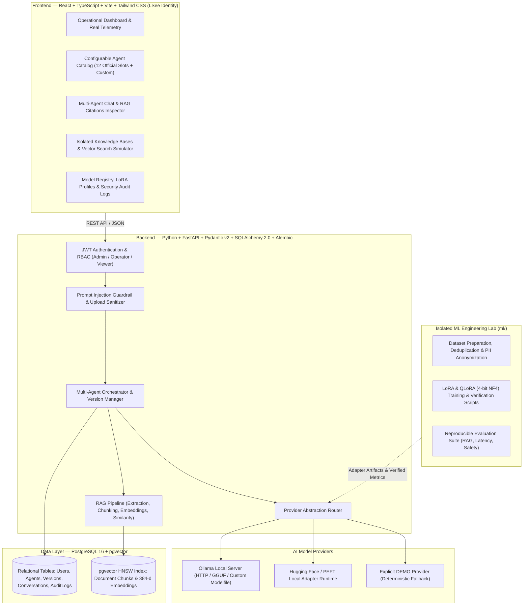

<div align="center">

# I.See Agents — Multi-Agent AI Platform

**Enterprise Multi-Agent Management, Orchestration, RAG Knowledge Bases, LoRA/QLoRA Specialization & Local LLM Inference**

[](https://www.python.org/)
[](https://fastapi.tiangolo.com/)
[](https://react.dev/)
[](https://www.typescriptlang.org/)
[](https://tailwindcss.com/)
[](https://github.com/pgvector/pgvector)
[](https://ollama.com/)
[](https://huggingface.co/)
[](https://www.docker.com/)

**Developer:** Júlio César  
**Company:** [I.See Technologies](https://iseetechnologies.com.br/)  
**Repository:** `securityMaker488/isee-agents`

</div>

---

## 1. Project Overview

**I.See Agents** is a full-stack Multi-Agent AI Engineering Platform built for **I.See Technologies** to manage, orchestrate, specialize, evaluate, and serve domain-specialized AI agents.

The platform combines:
- **Multi-Agent Orchestration & Versioned Registry**: Full lifecycle management of specialized agents (system prompts, inference parameters, tools, RAG pipelines, LoRA/QLoRA adapter metadata, test cases, and security guardrails).
- **Production-Grade RAG Pipeline**: Secure document and image ingestion, semantic chunking, dense embeddings, isolated vector retrieval with **PostgreSQL + `pgvector`**, and source-level citations.
- **Real Local Inference via Ollama**: Native HTTP integration with **Ollama** (`/api/tags`, `/api/chat`, `/api/embeddings`) plus a clearly labeled `[DEMO]` fallback simulator when running in environments without an active local LLM server.
- **Isolated ML & Fine-Tuning Laboratory (`ml/`)**: Reproducible pipelines for synthetic dataset preparation, PII anonymization, **LoRA (Low-Rank Adaptation)**, **QLoRA (4-bit NormalFloat NF4 + Double Quantization)**, and multi-dimensional agent evaluation—kept strictly isolated from the lightweight web API runtime.

---

## 2. System Architecture



---

## 3. Implemented Features

| Module | Status | Engineering Details |
| :--- | :---: | :--- |
| **Administrative Dashboard** | Implemented | Displays real database counts, live Ollama connectivity/latency, and 12-slot integration status. |
| **Configurable Agent Catalog** | Implemented | Supports creating, editing, versioning, evaluating, and filtering `[DEMO]` vs. official slot agents. |
| **12 Specialized Agent Slots** | Prepared | 12 structural slots (`slot_number` 1..12) reserved and ready for official JSON bundle import. |
| **Versioned Import / Export** | Implemented | Schema-validated (`isee-agent-definition/v2.0`) JSON bundle import/export with immutable snapshots. |
| **Persistent Multi-Agent Chat** | Implemented | Conversation history, per-message latency (`ms`), `tokens/s`, RAG citations, and provider badges. |
| **Ollama Integration** | Implemented | Real HTTP client for `/api/tags`, `/api/chat`, and `/api/embeddings` with transparent `[DEMO]` fallback. |
| **Knowledge Bases & RAG** | Implemented | Configurable `chunk_size`/`chunk_overlap`, `pgvector` HNSW support, cosine similarity, and tenant isolation. |
| **Secure Document & Image Processing** | Implemented | Extension allowlist, magic-byte inspection (`MZ`/`ELF`/`%PDF`), Pillow image verification, and SHA-256 hashing. |
| **Authentication & RBAC** | Implemented | Bcrypt password hashing, JWT bearer tokens, and role enforcement (`admin`, `operator`, `viewer`). |
| **Prompt Injection Guardrails** | Implemented | Pre-inference inspection blocking instruction overrides and system prompt exfiltration attempts, logged in `AuditLog`. |
| **ML & LoRA/QLoRA Laboratory** | Implemented | Synthetic dataset pipeline (`ml/datasets/`) and executable LoRA/QLoRA & evaluation scripts (`ml/experiments/`). |

---

## 4. Transparent Status of the 12 Original Agents

In strict compliance with engineering governance:
1. **No Fabricated Configurations**: The proprietary definitions of the **12 original I.See Technologies specialized agents** are not present in this workspace and have **not** been invented or falsely claimed as integrated.
2. **12 Structural Slots Ready**: Slots `#01` through `#12` are initialized in the database with `status="awaiting_integration"` and `is_original_slot_integrated=false`.
3. **Functional `[DEMO]` Agents Included**: Three fully functional demonstrative agents (`[DEMO] Arquiteto de IA & Especialista LoRA/QLoRA`, `[DEMO] Analista Documental & Auditoria RAG`, and `[DEMO] Guardião de Segurança em IA`) are pre-seeded along with a synthetic knowledge base so every feature of the platform can be verified immediately.
4. **One-Click / Single-API Import**: When the 12 official agent definitions become available, they can be imported directly via `POST /api/v1/agents/import/bundle` or the Catalog UI.

---

## 5. Installation & Quick Start

### Option A — Docker Compose (PostgreSQL 16 + `pgvector` + Backend + Frontend)

```bash
# 1. Copy environment template
cp .env.example .env

# 2. Build and start all services
docker compose up --build -d

# 3. Run database migrations (Alembic)
docker compose exec backend alembic upgrade head
```

- **Frontend UI**: `http://localhost:5173`
- **Backend REST API & OpenAPI Docs**: `http://localhost:8000/docs`

### Option B — Local Development (Backend + Frontend)

```bash
# 1. Start Backend API (defaults to local SQLite if PostgreSQL is not configured in .env)
cd backend
pip install -r requirements.txt
uvicorn app.main:app --host 0.0.0.0 --port 8000 --reload

# 2. Start Frontend Dev Server (in a separate terminal)
cd frontend
npm install
npm run dev
```

**Default Seeded Credentials (Development / Demo):**
- **Administrator**: `admin@iseetechnologies.com.br` / `ISeeAdmin#2026`
- **Operator**: `operator@iseetechnologies.com.br` / `ISeeOperator#2026`

---

## 6. Ollama Setup & Local Model Configuration

To switch inference from the `[DEMO]` fallback simulator to live local neural generation with **Ollama**:

```bash
# 1. Start the Ollama runtime
ollama serve

# 2. Pull the default base model and embedding model
ollama pull llama3.2:3b
ollama pull nomic-embed-text

# 3. Verify connectivity in I.See Agents Dashboard or via API:
curl http://localhost:8000/api/v1/system/ollama
```

For custom **LoRA / GGUF** adapter registration in Ollama (`Modelfile`), see [`docs/ai-training/11-ollama-integration.md`](docs/ai-training/11-ollama-integration.md).

---

## 7. AI Training & Specialization Documentation (`docs/`)

All deep-dive engineering documentation on LLMs, RAG, Fine-Tuning, **LoRA**, **QLoRA**, Datasets, Evaluation, and Deployment is organized in [`docs/`](docs/):

### Architecture & Security
- [`docs/architecture/overview.md`](docs/architecture/overview.md) — System Architecture & Runtime Separation
- [`docs/architecture/multi-agent-system.md`](docs/architecture/multi-agent-system.md) — Multi-Agent Registry & 12-Slot Contract
- [`docs/security/security-overview.md`](docs/security/security-overview.md) — RBAC, RAG Tenant Isolation, Upload Sanitization & Prompt Guardrails

### AI Engineering & Fine-Tuning (`docs/ai-training/`)
1. [`01-llm-fundamentals.md`](docs/ai-training/01-llm-fundamentals.md) — Transformers, Self-Attention, Tokenization, KV Cache, Quantization & Decoding Parameters
2. [`02-prompt-engineering.md`](docs/ai-training/02-prompt-engineering.md) — Specialization Trade-offs: System Prompts vs. Few-Shot vs. RAG vs. PEFT/SFT vs. DPO
3. [`03-rag-and-embeddings.md`](docs/ai-training/03-rag-and-embeddings.md) — Document Extraction, Semantic Chunking, Embeddings & `pgvector` HNSW Indexing
4. [`04-fine-tuning.md`](docs/ai-training/04-fine-tuning.md) — Supervised Fine-Tuning (SFT), Full Fine-Tuning vs. PEFT, VRAM Budgets & Catastrophic Forgetting
5. [`05-lora.md`](docs/ai-training/05-lora.md) — **LoRA (Low-Rank Adaptation)**: Mathematical Formulation ($\Delta W = \frac{\alpha}{r}BA$), Rank/Alpha/Dropout, Target Modules & PEFT Code
6. [`06-qlora.md`](docs/ai-training/06-qlora.md) — **QLoRA (Quantized Low-Rank Adaptation)**: 4-bit NormalFloat (NF4), Double Quantization, Paged Optimizers & `bitsandbytes`
7. [`07-datasets.md`](docs/ai-training/07-datasets.md) — Authorized Data Collection, JSONL Formats, Deduplication, PII Anonymization & Zero-Leakage Splits
8. [`08-training-pipeline.md`](docs/ai-training/08-training-pipeline.md) — End-to-End 13-Step Reproducible Training Pipeline (`ml/experiments/`)
9. [`09-model-evaluation.md`](docs/ai-training/09-model-evaluation.md) — Factual Quality, RAG Recall@K/MRR, Latency, RAM/VRAM Telemetry & Red-Teaming
10. [`10-agent-specialization.md`](docs/ai-training/10-agent-specialization.md) — Specializing the 12 Agents Without Training 12 Separate Monolithic Models
11. [`11-ollama-integration.md`](docs/ai-training/11-ollama-integration.md) — Local Inference, Custom `Modelfile` Adapters, FastAPI Integration & Debian Resource Management
12. [`12-hardware-requirements.md`](docs/ai-training/12-hardware-requirements.md) — Realistic Hardware Sizing for Inference, RAG, LoRA (16-bit) & QLoRA (4-bit) across 0.5B–70B Models

### Deployment (`docs/deployment/`)
- [`docs/deployment/debian.md`](docs/deployment/debian.md) — Native Production Deployment on Debian Linux 12 (Bookworm)
- [`docs/deployment/docker.md`](docs/deployment/docker.md) — Containerized Deployment with Docker Compose & `pgvector`

---

## 8. Reproducible ML Experiments & Automated Tests

Run the isolated ML pipelines and automated test suites from the repository root:

```bash
# 1. Prepare, deduplicate, and anonymize the synthetic dataset
python ml/datasets/prepare_dataset.py

# 2. Execute verifiable Low-Rank Adaptation (LoRA) & 4-bit NF4 (QLoRA) verification
python ml/experiments/train_lora.py
python ml/experiments/train_qlora.py
python ml/experiments/inference_compare.py

# 3. Execute multi-dimensional agent evaluation (RAG Recall@K, MRR, Prompt Injection, PII)
python ml/experiments/evaluate_agent.py

# 4. Run full Backend, Security, RAG & ML automated test suite
python -m unittest discover -s tests -v

# 5. Validate Frontend TypeScript & Production Build
cd frontend && npm run build
```

### Real Verified Execution Summary

| Verification Suite | Result | Measured Metrics |
| :--- | :---: | :--- |
| **Backend API, Auth, RBAC, RAG & Security (`tests/backend/`)** | **PASS (5/5 suites)** | JWT/RBAC enforced, 12 slots protected, `.exe`/`MZ` uploads blocked, tenant isolation verified, prompt injection blocked. |
| **ML Pipeline & Quantization (`tests/ml/`)** | **PASS (4/4 suites)** | 0% data leakage across train/val/test, 100% PII redaction, base weights verified frozen (`W0` unchanged), 99.22% parameter reduction (7B budget), 74.22% memory reduction vs. FP16 with 4-bit NF4 + Double Quantization (`RMSE = 0.001849`). |
| **RAG & Security Evaluation (`ml/experiments/evaluate_agent.py`)** | **PASS** | `Recall@1 = 1.0`, `MRR = 1.0`, Prompt Injection detection accuracy `100% (6/6)`, Zero PII leakage. |

---

## 9. Roadmap

- [x] **Phase 1 — Foundation**: Isolated monorepo, FastAPI + SQLAlchemy 2.0 + Alembic, PostgreSQL `pgvector`, React + TypeScript + Tailwind UI.
- [x] **Phase 2 — Agents & Orchestration**: JWT/RBAC, configurable agent catalog, 12 reserved slots, versioned JSON import/export, Ollama + explicit `[DEMO]` providers.
- [x] **Phase 3 — Knowledge & RAG**: Secure document/image ingestion, configurable chunking, embeddings, similarity search with citations, and tenant isolation.
- [x] **Phase 4 — ML Engineering & Documentation**: Synthetic dataset pipeline, LoRA/QLoRA verification labs, evaluation suite, and 17 engineering guides in `docs/`.
- [x] **Phase 5 — Quality & Security**: Automated integration, RBAC, RAG isolation, upload sanitization, and prompt injection tests.
- [ ] **Future Milestone**: Import of the 12 official specialized agent definitions from I.See Technologies into slots `#01–#12` and optional QLoRA adapter training on dedicated CUDA GPU hardware.

---

<div align="center">
  <sub>Developed by <b>Júlio César</b> — <a href="https://iseetechnologies.com.br/">I.See Technologies</a></sub>
</div>
