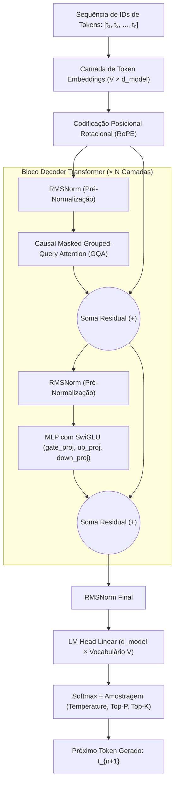

# 01 — Fundamentos de Large Language Models (LLMs)

**Projeto:** I.See Agents — Multi-Agent AI Platform  
**Módulo:** Engenharia e Treinamento de IA (`docs/ai-training/`)  
**Escopo do Documento:** Documentação Conceitual, Matemática e Exemplos Executáveis em PyTorch.

---

## 1. Arquitetura Transformer e Mecanismos de Atenção

Introduzida por Vaswani et al. (2017) no artigo *"Attention Is All You Need"*, a arquitetura **Transformer** substituiu redes recorrentes (RNNs/LSTMs) ao eliminar a dependência sequencial estrita durante a etapa de treinamento, permitindo paralelização massiva em GPUs através do mecanismo de **Self-Attention (Autoatenção)**.

Os LLMs modernos utilizados na plataforma I.See Agents (como famílias **Llama 3**, **Qwen 2.5**, **Mistral** e **Gemma**) baseiam-se na variante **Decoder-Only Transformer** (arquitetura autorregressiva causal).



### 1.1 Scaled Dot-Product Attention (Equação Fundamental)

Para cada token na sequência de entrada, o vetor de estado oculto $x_i \in \mathbb{R}^{d_{\text{model}}}$ é projetado linearmente em três representações vetoriais usando matrizes de pesos aprendidas $W_Q, W_K, W_V$:
- **Query ($Q = X W_Q$):** O que o token atual está buscando no contexto.
- **Key ($K = X W_K$):** O "rótulo" indexável que cada token oferece aos demais.
- **Value ($V = X W_V$):** O conteúdo informacional real que será agregado.

A atenção produto-escalar escalonada é definida matematicamente por:

$$\text{Attention}(Q, K, V) = \text{softmax}\left(\frac{QK^T}{\sqrt{d_k}} + M\right)V$$

Onde:
- $Q \in \mathbb{R}^{n \times d_k}$, $K \in \mathbb{R}^{n \times d_k}$ e $V \in \mathbb{R}^{n \times d_v}$ (sendo $n$ o comprimento da sequência e $d_k$ a dimensão de cada cabeça de atenção).
- **Por que dividir por $\sqrt{d_k}$?** Quando $d_k$ é grande, o produto escalar $q \cdot k$ assume magnitudes elevadas (variância proporcional a $d_k$), empurrando a função $\text{softmax}$ para regiões de saturação onde os gradientes tornam-se extremamente pequenos ($\approx 0$), causando *vanishing gradients*. O fator $\frac{1}{\sqrt{d_k}}$ normaliza a variância de volta para $1$.
- $M \in \mathbb{R}^{n \times n}$ é a **Máscara Causal Triangular Superior**, onde $M_{i,j} = 0$ se $j \le i$ e $M_{i,j} = -\infty$ se $j > i$. Isso garante que o token na posição $i$ jamais enxergue tokens futuros ($j > i$).

### 1.2 Multi-Head Attention (MHA) vs. Grouped-Query Attention (GQA)

Em vez de calcular uma única atenção de dimensão $d_{\text{model}}$, o **Multi-Head Attention (MHA)** divide a representação em $h$ cabeças paralelas ($d_k = d_{\text{model}} / h$), permitindo que o modelo capture simultaneamente relações sintáticas, semânticas e posicionais em diferentes subespaços:

$$\text{MHA}(Q, K, V) = \text{Concat}(\text{head}_1, \dots, \text{head}_h)W_O, \quad \text{onde } \text{head}_i = \text{Attention}(QW_Q^{(i)}, KW_K^{(i)}, VW_V^{(i)})$$

Entretanto, durante a inferência de contextos longos, armazenar tensores $K$ e $V$ para todas as $h$ cabeças no **KV Cache** torna-se um gargalo severo de memória VRAM e largura de banda. Para mitigar isso, modelos modernos como **Llama 3** e **Qwen 2.5** utilizam **Grouped-Query Attention (GQA)**:

| Arquitetura de Atenção | Proporção Cabeças $Q$ vs. $K/V$ | Impacto no KV Cache (VRAM) | Qualidade / Perplexidade |
| :--- | :--- | :--- | :--- |
| **Multi-Head Attention (MHA)** | $h_Q = h_{KV}$ (1 para 1) | Alto consumo ($100\%$ baseline) | Máxima capacidade expressiva |
| **Multi-Query Attention (MQA)** | $h_Q$ cabeças compartilham $1$ único par $K, V$ | Redução drástica ($\approx 1/h_Q$) | Leve degradação de qualidade |
| **Grouped-Query Attention (GQA)** | $h_Q$ cabeças divididas em $g$ grupos ($1 < g < h_Q$) | Redução de $4\times$ a $8\times$ no KV Cache | Praticamente idêntica ao MHA |

---

## 2. Tokenização e Embeddings Densos

Modelos de linguagem operam sobre tensores numéricos, não sobre strings brutas. O **Tokenizador** converte texto em uma sequência discreta de inteiros $t_i \in \{0, 1, \dots, |V|-1\}$, onde $|V|$ é o tamanho do vocabulário (ex.: $128.256$ no Llama 3; $151.936$ no Qwen 2.5).

### 2.1 Algoritmos de Subpalavras (*Subword Tokenization*)

Tokenizar por palavras inteiras falha diante de neologismos e morfologias ricas (como o português), enquanto tokenizar por caracteres puros gera sequências excessivamente longas. A solução padrão na indústria é a tokenização por subpalavras:

1. **BPE (Byte-Pair Encoding) / Byte-Level BPE:** Inicia com bytes individuais (256 símbolos base) e funde iterativamente os pares de bytes/símbolos mais frequentes no corpus de treinamento. É o algoritmo base do `tiktoken` (OpenAI) e dos tokenizadores do Llama 3 e Qwen 2.5. Como opera em nível de byte UTF-8, **nunca produz tokens `<unk>` (desconhecidos)**.
2. **WordPiece:** Similar ao BPE, mas seleciona fusões que maximizam a verossimilhança (*likelihood*) dos dados de treino em vez da frequência bruta (usado na família BERT).
3. **SentencePiece (Unigram / BPE):** Trata o fluxo de texto bruto como uma sequência Unicode (incluindo espaços representados por ` ` / U+2581), sem depender de pré-tokenização por espaço em branco — essencial para idiomas sem separação de palavras e para preservação reversível de código-fonte.

### 2.2 Dos Token IDs aos Vetores Densos (Embeddings)

Cada ID inteiro $t_i$ funciona como um índice de linha em uma matriz de busca aprendida $W_E \in \mathbb{R}^{|V| \times d_{\text{model}}}$. Enquanto um vetor *one-hot* teria dimensão $|V| \approx 150.000$ esparsa e ortogonal (onde a similaridade entre "rei" e "monarca" seria zero), o **embedding denso** projeta o token em um espaço contínuo $\mathbb{R}^{d_{\text{model}}}$ (tipicamente $2048$, $3072$ ou $4096$ dimensões), onde proximidade geométrica reflete proximidade semântica e funcional.

---

## 3. Modelos Base (Pretrained) vs. Instruction-Tuned / Chat Models

Compreender a diferença entre um modelo Base e um modelo Instruct/Chat é crítico para a engenharia de sistemas multi-agente:

| Característica | Modelo Base (ex.: `Qwen2.5-7B`) | Modelo Instruct / Chat (ex.: `Qwen2.5-7B-Instruct`) |
| :--- | :--- | :--- |
| **Objetivo de Treinamento** | *Next-token prediction* auto-supervisionado em trilhões de tokens brutos da web, livros e código. | Pós-treinamento via **SFT** (Supervised Fine-Tuning) em pares `(instrução, resposta)` + alinhamento via **RLHF/DPO**. |
| **Comportamento frente a uma Pergunta** | Tende a continuar o texto (ex.: se você envia uma pergunta, ele pode gerar mais 5 perguntas parecidas como se fosse uma prova). | Reconhece o papel do usuário (`<\|user\|>`) e responde diretamente como assistente (`<\|assistant\|>`). |
| **Chat Template** | Não possui marcadores estruturais de turno de conversa. | Exige formatação estrita de tokens especiais (ChatML, Llama-3 template) para delimitar System, User e Assistant. |
| **Uso na Plataforma I.See Agents** | Ponto de partida para experimentos avançados de *Continued Pretraining* ou SFT customizado no diretório `ml/`. | **Padrão obrigatório para o Runtime de Produção**, agentes conversacionais, RAG e uso de ferramentas. |

---

## 4. Inferência Autorregressiva, KV Cache e Janela de Contexto

A geração de texto em um LLM ocorre de forma **autorregressiva**: para gerar $N$ tokens de resposta, o modelo executa $N$ passos sequenciais (*forward passes*), onde o token amostrado no passo $t$ é concatenado à entrada para prever o token do passo $t+1$:

$$P(y_1, y_2, \dots, y_T \mid x) = \prod_{t=1}^{T} P(y_t \mid x, y_1, \dots, y_{t-1})$$

### 4.1 As Duas Fases da Inferência e o Papel do KV Cache

1. **Fase de Prefill (Processamento do Prompt):** Todos os tokens de entrada (System Prompt + Contexto RAG + Pergunta do Usuário) são processados **em paralelo** em uma única operação matricial. O gargalo aqui é **Compute-Bound** (limitado pelos FLOPs da GPU/CPU). Durante essa fase, os tensores $K$ e $V$ de todas as camadas são calculados e salvos na memória — estrutura conhecida como **KV Cache**.
2. **Fase de Decoding (Geração Token a Token):** A cada novo token gerado, graças ao KV Cache, **não é necessário recalcular $K$ e $V$ dos tokens anteriores**.Calcula-se apenas $q_{\text{novo}}, k_{\text{novo}}, v_{\text{novo}}$ do último token e anexa-se $k_{\text{novo}}, v_{\text{novo}}$ ao cache. O gargalo aqui é **Memory-Bandwidth-Bound** (limitado pela velocidade de leitura dos pesos do modelo e do KV Cache na VRAM).

**Fórmula de Consumo de Memória do KV Cache (por requisição):**

$$\text{VRAM}_{\text{KV Cache (Bytes)}} = 2 \times n_{\text{layers}} \times n_{\text{kv\_heads}} \times d_{\text{head}} \times \text{seq\_len} \times \text{bytes\_per\_element}$$

*(O fator $2$ corresponde aos tensores $K$ e $V$).*

---

## 5. Quantização de Modelos (FP32, FP16, BF16, INT8, NF4 e GGUF)

Um modelo de $7$ bilhões de parâmetros ($7\text{B}$) armazenado em precisão simples de 32 bits (`FP32`, 4 bytes por parâmetro) exige $7 \times 10^9 \times 4 \text{ bytes} \approx 28 \text{ GB}$ apenas para carregar os pesos em memória. A **quantização** reduz a precisão numérica dos pesos (e opcionalmente das ativações) para diminuir drasticamente o uso de VRAM e acelerar a transferência de memória:

| Formato | Bits / Peso | Estrutura Numérica | Bytes por 1B Params | Aplicação Principal |
| :--- | :---: | :--- | :---: | :--- |
| **FP32** | 32 bits | 1 sinal, 8 expoente, 23 mantissa | $\approx 4.0\text{ GB}$ | Pesos mestres de otimizadores (`AdamW`) |
| **FP16** | 16 bits | 1 sinal, 5 expoente, 10 mantissa | $\approx 2.0\text{ GB}$ | Inferência padrão em GPUs; requer *loss scaling* no treino |
| **BF16 (BFloat16)** | 16 bits | 1 sinal, **8 expoente**, 7 mantissa | $\approx 2.0\text{ GB}$ | **Padrão ouro para treinamento/LoRA** (mesmo alcance dinâmico do FP32, evita overflow/underflow) |
| **INT8 (LLM.int8)** | 8 bits | Inteiros uniformes $[-128, 127]$ | $\approx 1.0\text{ GB}$ | Inferência com perda de precisão desprezível |
| **NF4 (NormalFloat 4)** | 4 bits | Quantis teoricamente ótimos para distribuição Normal $\mathcal{N}(0, \sigma^2)$ | $\approx 0.55\text{ GB}$ | **Base do QLoRA** (`bitsandbytes`) para ajuste fino em 4-bit |
| **GGUF (ex.: Q4_K_M)** | ~4.5 bits | Superblocos com escalas mistas (*K-quants*) | $\approx 0.60\text{ GB}$ | **Inferência de alta eficiência via Ollama / `llama.cpp`** (CPU + GPU offloading) |

---

## 6. Pesos, Hiperparâmetros de Treino e Parâmetros de Decodificação

É fundamental não confundir três categorias distintas de variáveis:

1. **Parâmetros do Modelo (Pesos $W$):** Valores aprendidos durante o treinamento via gradiente descendente (matrizes de projeção $W_Q, W_K, W_V, W_O$, MLPs e embeddings). São fixos durante a inferência.
2. **Hiperparâmetros de Treinamento:** Definidos pelo engenheiro de ML antes do treino: `learning_rate` ($\eta$), `batch_size`, `weight_decay`, rank `r` do LoRA, `lora_alpha`, `warmup_ratio`.
3. **Hiperparâmetros de Inferência (Amostragem/Decodificação):** Controlam como a distribuição de probabilidades (logits $z \in \mathbb{R}^{|V|}$) na saída do modelo é convertida na escolha do próximo token:
   - **`temperature` ($T$):** Escala os logits antes do softmax: $P_i = \frac{\exp(z_i / T)}{\sum_j \exp(z_j / T)}$.
     - $T \to 0$ (*Greedy Decoding*): Determinístico; escolhe sempre o token de maior probabilidade. Ideal para SQL, código, extração JSON e RAG factual.
     - $T \in [0.6, 0.9]$: Aumenta a entropia da distribuição, favorecendo fluidez criativa.
   - **`top_k`:** Restringe a amostragem apenas aos $K$ tokens mais prováveis, zerando a probabilidade de toda a "cauda longa" do vocabulário.
   - **`top_p` (Nucleus Sampling):** Ordena os tokens de forma decrescente por probabilidade e mantém o menor subconjunto cuja soma cumulativa de probabilidades atinge o limiar $p$ (ex.: $p = 0.90$). Adapta-se dinamicamente à incerteza do modelo no passo atual.
   - **`repetition_penalty`:** Aplica um fator divisor aos logits de tokens que já apareceram no prompt ou na resposta gerada até o momento, evitando loops degenerativos de repetição.

### 6.1 Exemplo Executável: Inspeção Matemática de Atenção e Amostragem em PyTorch

O trecho abaixo pode ser executado localmente com `python` (requer apenas `torch`) para demonstrar o cálculo exato do *Scaled Dot-Product Attention* com máscara causal e o efeito da temperatura nos logits:

```python
import math
import torch
import torch.nn.functional as F

def causal_self_attention_demo(seq_len: int = 4, d_k: int = 8) -> None:
    torch.manual_seed(42)
    # Matrizes simuladas Q, K, V de formato (batch=1, seq_len=4, d_k=8)
    Q = torch.randn(1, seq_len, d_k)
    K = torch.randn(1, seq_len, d_k)
    V = torch.randn(1, seq_len, d_k)

    # 1. Produto escalar escalonado: (Q @ K^T) / sqrt(d_k)
    scores = torch.matmul(Q, K.transpose(-2, -1)) / math.sqrt(d_k)

    # 2. Máscara causal triangular inferior (impede olhar para tokens futuros)
    causal_mask = torch.tril(torch.ones(seq_len, seq_len)).unsqueeze(0)
    scores = scores.masked_fill(causal_mask == 0, float("-inf"))

    # 3. Pesos de atenção via Softmax
    attn_weights = F.softmax(scores, dim=-1)

    # 4. Combinação ponderada dos Valores (V)
    context_vectors = torch.matmul(attn_weights, V)

    print("Matriz de Pesos de Atenção Causal (Soma de cada linha = 1.0):")
    print(attn_weights.squeeze(0).round(decimals=3))
    print("\nDimensão de saída do contexto:", context_vectors.shape)

if __name__ == "__main__":
    causal_self_attention_demo()
```

---

## 7. Comparação Técnica e de Custo: Pré-Treinamento vs. Fine-Tuning vs. Inferência

| Dimensão | Pré-Treinamento (*Pretraining*) | Fine-Tuning Supervisionado (SFT / QLoRA) | Inferência em Produção ( + RAG) |
| :--- | :--- | :--- | :--- |
| **Objetivo** | Ensinar língua, gramática, conhecimento de mundo e raciocínio geral a partir do zero (pesos aleatórios). | Adaptar estilo de resposta, formato estruturado, comportamento de domínio ou alinhamento sobre um modelo pré-treinado. | Resolver tarefas do usuário em tempo real combinando a capacidade do modelo com instruções e dados recuperados. |
| **Volume de Dados** | $2$ a $18+$ **Trilhões** de tokens não-rotulados. | $500$ a $100.000$ exemplos curados de alta qualidade (`instruction` / `output`). | $1$ requisição por vez (com $1\text{k}$ a $32\text{k}$ tokens de contexto dinâmico). |
| **Infraestrutura Típica** | Clusters de centenas/milhares de GPUs H100/A100 interconectadas via NVLink/InfiniBand. | **LoRA/QLoRA:** $1$ única GPU (8 GB a 24 GB VRAM) por minutos ou poucas horas.<br>**Full FT:** Múltiplas GPUs de 80 GB. | **CPU moderna ou 1 GPU modesta** (ex.: execução local via Ollama em modelos 3B–8B Q4_K_M). |
| **Operações no Grafo** | Forward + Backward completo em 100% dos parâmetros + Estados do otimizador. | Forward no modelo base congelado + Backward apenas nas matrizes de baixo posto ($< 1\%$ a $2\%$ dos pesos). | **Apenas Forward pass** (`torch.no_grad()`), sem gradientes e sem estados de otimizador. |
| **Frequência de Atualização de Conhecimento** | Estático (congelado na data de corte do corpus). | Estático por versão de adaptador treinado. | **Instantâneo** quando combinado com indexação vetorial RAG (`pgvector`). |
| **Papel no I.See Agents** | Consumimos modelos fundacionais abertos já pré-treinados pela comunidade (Meta, Alibaba Qwen, Mistral). | Suportado no laboratório isolado `ml/` via scripts reproduzíveis de LoRA/QLoRA. | **Núcleo do Runtime da Plataforma** para os 12 agentes originais e agentes customizados. |
