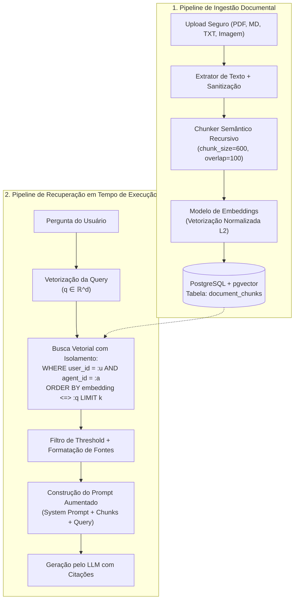

# 03 — RAG (Retrieval-Augmented Generation) e Embeddings Vetoriais

**Projeto:** I.See Agents — Multi-Agent AI Platform  
**Módulo:** Engenharia e Treinamento de IA (`docs/ai-training/`)  
**Escopo do Documento:** Arquitetura Integrada na Plataforma (`PostgreSQL + pgvector`), Matemática Vetorial e Métricas de Recuperação.

---

## 1. Visão Geral da Arquitetura RAG no I.See Agents

**Retrieval-Augmented Generation (RAG)** é o padrão arquitetural que conecta um modelo de linguagem parametrizado (memória paramétrica estática) a uma base de conhecimento externa pesquisável (memória não-paramétrica dinâmica).

Na plataforma **I.See Agents**, o pipeline RAG é uma **funcionalidade nativa e integrada ao runtime**, dividida em dois fluxos assíncronos principais:
1. **Pipeline de Ingestão e Indexação (*Offline / On-Upload*):** Validação segura do arquivo $\rightarrow$ Extração limpa de texto $\rightarrow$ Segmentação semântica (*Chunking*) $\rightarrow$ Vetorização (*Embedding Generation*) $\rightarrow$ Persistência transacional no PostgreSQL com `pgvector`.
2. **Pipeline de Recuperação e Geração (*Online / At-Query-Time*):** Vetorização da pergunta do usuário $\rightarrow$ Busca de vizinhos mais próximos (*ANN Search*) filtrada por `user_id` e `agent_id` $\rightarrow$ Filtragem por limiar de similaridade $\rightarrow$ Montagem do prompt aumentado com citações auditáveis.



---

## 2. Extração Segura de Texto e Estratégias de Chunking

A qualidade de um sistema RAG é limitada pela qualidade dos seus chunks (*Garbage In, Garbage Out*). Indexar um documento inteiro de 50 páginas em um único vetor dilui o significado semântico; por outro lado, fragmentar em frases isoladas de 20 caracteres destrói o contexto circundante.

### 2.1 Extração e Higienização por Formato
- **Arquivos Markdown (`.md`) e Texto (`.txt`):** Decodificação UTF-8 estrita com fallback seguro (`latin-1`), normalização Unicode (`NFKC`) e preservação de cabeçalhos estruturais (`#`, `##`).
- **Documentos PDF (`.pdf`):** Extração página a página via `pypdf`/`pdfplumber`, preservando o metadado `page_number` para citação exata e removendo quebras de linha artificiais de hifenização.
- **Imagens (`.png`, `.jpg`, `.webp`):** Extração de metadados estruturais (dimensões, formato, legendas associadas) e suporte extensível a OCR (`pytesseract` / Vision APIs) para indexação de diagramas e documentos digitalizados.

### 2.2 Parâmetros de Chunking (`chunk_size` e `chunk_overlap`)

Utilizamos **Segmentação Recursiva por Separadores Semânticos**, que tenta dividir o texto respeitando a hierarquia natural do documento na seguinte ordem de prioridade:
1. Dupla quebra de linha (`\n\n` — parágrafos e seções Markdown)
2. Quebra de linha simples (`\n`)
3. Fim de sentença (`. `, `! `, `? `)
4. Espaço em branco (` `)

| Parâmetro | Valor Padrão no I.See Agents | Justificativa de Engenharia |
| :--- | :---: | :--- |
| **`chunk_size`** | `500` a `800` caracteres ($\approx 150\text{–}220$ tokens) | Captura um parágrafo técnico completo ou uma regra de negócio inteira sem misturar múltiplos tópicos distintos no mesmo vetor. |
| **`chunk_overlap`** | `80` a `120` caracteres ($\approx 15\%\text{–}20\%$) | Garante **continuidade contextual** nas fronteiras de corte, impedindo que uma premissa no final do Chunk $i$ seja separada da sua conclusão no início do Chunk $i+1$. |

### 2.3 Implementação Reproduzível do Chunker Semântico

```python
from typing import List, Dict, Any

def semantic_chunk_text(
    text: str,
    chunk_size: int = 600,
    chunk_overlap: int = 100,
) -> List[Dict[str, Any]]:
    """
    Divide um texto longo em chunks preservando fronteiras de parágrafos e sentenças,
    com sobreposição deslizante (sliding window overlap) e rastreamento de offset.
    """
    if chunk_overlap >= chunk_size:
        raise ValueError("chunk_overlap deve ser estritamente menor que chunk_size.")

    cleaned = text.replace("\r\n", "\n").strip()
    if not cleaned:
        return []

    chunks: List[Dict[str, Any]] = []
    start = 0
    text_length = len(cleaned)
    chunk_idx = 0

    while start < text_length:
        end = min(start + chunk_size, text_length)

        # Se não chegamos ao fim do texto, recuamos até o separador semântico mais próximo
        if end < text_length:
            for sep in ["\n\n", "\n", ". ", "; ", " "]:
                last_sep = cleaned.rfind(sep, start + int(chunk_size * 0.5), end)
                if last_sep != -1:
                    end = last_sep + len(sep)
                    break

        chunk_str = cleaned[start:end].strip()
        if chunk_str:
            chunks.append({
                "chunk_index": chunk_idx,
                "content": chunk_str,
                "char_start": start,
                "char_end": end,
                "token_estimate": max(1, len(chunk_str) // 4),
            })
            chunk_idx += 1

        if end >= text_length:
            break
        start = max(start + 1, end - chunk_overlap)

    return chunks
```

---

## 3. Espaços Vetoriais e Métricas de Similaridade

Um modelo de embedding $f_{\theta}: \mathcal{T} \to \mathbb{R}^d$ mapeia qualquer trecho de texto para um ponto em uma hipersfera de dimensão $d$ (ex.: $d = 384$ para `all-MiniLM-L6-v2` / `bge-small`, $d = 768$ para `nomic-embed-text` / `bge-base`).

Dadas duas representações vetoriais $\mathbf{u}, \mathbf{v} \in \mathbb{R}^d$, existem três métricas geométricas fundamentais suportadas pelo `pgvector`:

### 3.1 Similaridade Cosseno e Distância Cosseno (`<=>`)
Mede o cosseno do ângulo $\theta$ entre dois vetores, sendo invariante à magnitude (comprimento) dos vetores:

$$\text{CosineSimilarity}(\mathbf{u}, \mathbf{v}) = \frac{\mathbf{u} \cdot \mathbf{v}}{\|\mathbf{u}\|_2 \|\mathbf{v}\|_2} = \frac{\sum_{i=1}^d u_i v_i}{\sqrt{\sum_{i=1}^d u_i^2}\sqrt{\sum_{i=1}^d v_i^2}} \in [-1, 1]$$

No `pgvector`, o operador `<=>` calcula a **Distância Cosseno**:

$$\text{CosineDistance}(\mathbf{u}, \mathbf{v}) = 1 - \text{CosineSimilarity}(\mathbf{u}, \mathbf{v}) \in [0, 2]$$

Portanto, para recuperar a similaridade normalizada no SQL: `1 - (embedding <=> :query_vec) AS similarity_score`.

### 3.2 Distância Euclidiana / L2 (`<->`)
Calcula a distância em linha reta entre as extremidades dos vetores no espaço $\mathbb{R}^d$:

$$d_{L_2}(\mathbf{u}, \mathbf{v}) = \|\mathbf{u} - \mathbf{v}\|_2 = \sqrt{\sum_{i=1}^d (u_i - v_i)^2}$$

### 3.3 Produto Interno Negativo (`<#>`)
Quando todos os vetores são previamente **normalizados em norma $L_2$** ($\|\mathbf{u}\|_2 = \|\mathbf{v}\|_2 = 1$), a similaridade cosseno reduz-se exatamente ao produto escalar $\mathbf{u} \cdot \mathbf{v}$, economizando operações de raiz quadrada por comparação.

---

## 4. Indexação Vetorial com PostgreSQL + `pgvector`

Em bases pequenas ($< 10.000$ chunks), uma varredura sequencial exata (*Exact Nearest Neighbor* — KNN) leva poucos milissegundos. À medida que a base cresce para centenas de milhares ou milhões de chunks, utilizamos índices de **Busca Aproximada de Vizinhos Mais Próximos (ANN)**:

| Tipo de Índice `pgvector` | Algoritmo Subjacente | Velocidade de Busca (QPS) | Recall@K | Custo de Construção / RAM | Recomendação de Engenharia |
| :--- | :--- | :---: | :---: | :---: | :--- |
| **HNSW** (`using hnsw`) | Grafo navegável multicamada (*Hierarchical Navigable Small World*) | **Muito Alta** | **Excelente ($> 0.98$)** | Maior uso de RAM e build mais lento | **Padrão recomendado em produção no I.See Agents** (suporta inserções dinâmicas sem retreinar clusters). |
| **IVFFlat** (`using ivfflat`) | Clusterização K-Means invertida (*Inverted File with Flat Vectors*) | Alta | Moderado ($\approx 0.90\text{–}0.95$) | Menor consumo de RAM | Útil apenas quando a memória RAM do banco é estritamente restrita e a tabela já possui dados populados antes de criar o índice. |

### 4.1 DDL e Query SQL de Produção com Isolamento Multi-Agente

```sql
-- 1. Habilitar extensão vetorial no PostgreSQL
CREATE EXTENSION IF NOT EXISTS vector;

-- 2. Estrutura da tabela de chunks com isolamento estrito por usuário e agente
CREATE TABLE IF NOT EXISTS document_chunks (
    id UUID PRIMARY KEY,
    document_id UUID NOT NULL REFERENCES documents(id) ON DELETE CASCADE,
    user_id UUID NOT NULL REFERENCES users(id) ON DELETE CASCADE,
    agent_id UUID NOT NULL REFERENCES agents(id) ON DELETE CASCADE,
    chunk_index INTEGER NOT NULL,
    content TEXT NOT NULL,
    metadata_json JSONB DEFAULT '{}'::jsonb,
    embedding vector(384) NOT NULL,
    created_at TIMESTAMPTZ NOT NULL DEFAULT NOW()
);

-- 3. Índice composto B-Tree para filtragem multi-tenant rápida
CREATE INDEX IF NOT EXISTS idx_chunks_user_agent 
    ON document_chunks (user_id, agent_id);

-- 4. Índice Vetorial HNSW para Distância Cosseno (vector_cosine_ops)
CREATE INDEX IF NOT EXISTS idx_chunks_embedding_hnsw 
    ON document_chunks 
    USING hnsw (embedding vector_cosine_ops)
    WITH (m = 16, ef_construction = 64);

-- 5. Query de Recuperação Semântica com Isolamento e Threshold
SELECT
    dc.id AS chunk_id,
    d.filename AS source_filename,
    dc.chunk_index,
    dc.content,
    ROUND((1 - (dc.embedding <=> :query_embedding::vector))::numeric, 4) AS similarity
FROM document_chunks dc
JOIN documents d ON d.id = dc.document_id
WHERE dc.user_id = :current_user_id
  AND dc.agent_id = :target_agent_id
  AND (1 - (dc.embedding <=> :query_embedding::vector)) >= :min_similarity_threshold
ORDER BY dc.embedding <=> :query_embedding::vector ASC
LIMIT :top_k;
```

---

## 5. Avaliação Científica de Sistemas RAG (Métricas de Qualidade)

No laboratório `ml/evaluation/`, avaliamos o pipeline RAG separando métricas de **Recuperação (*Retrieval*)** e métricas de **Geração (*Generation*)**:

### 5.1 Métricas de Recuperação
1. **Recall@K:** Proporção de consultas em que o documento/chunk relevante verdadeiro aparece entre os top-$K$ resultados retornados:
   $$\text{Recall}@K = \frac{|\text{Chunks Relevantes Recuperados no Top-}K|}{|\text{Total de Chunks Relevantes para a Query}|}$$
2. **MRR (Mean Reciprocal Rank):** Avalia quão perto do topo ($1^\circ$ lugar) o primeiro resultado relevante foi posicionado em um conjunto de $Q$ queries:
   $$\text{MRR} = \frac{1}{|Q|} \sum_{q=1}^{|Q|} \frac{1}{\text{rank}_q}$$
   *(Se o chunk correto aparece em $1^\circ$ lugar, vale $1.0$; se aparece em $2^\circ$, vale $0.5$; em $4^\circ$, vale $0.25$).*

### 5.2 Métricas de Geração (Tríade RAG)
- **Context Relevance (Relevância do Contexto):** Os chunks recuperados contêm informação útil para a pergunta ou apenas ruído?
- **Faithfulness / Groundedness (Fidelidade às Fontes):** A resposta gerada pelo agente atém-se estritamente aos fatos presentes nos chunks recuperados, sem inventar dados extrapolados?
- **Answer Relevance (Relevância da Resposta):** A resposta final atende diretamente à intenção da pergunta do usuário?
