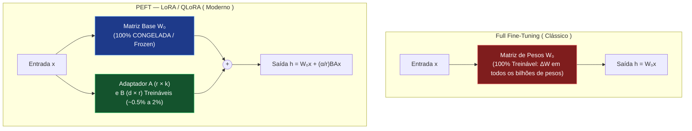

# 04 — Fundamentos de Fine-Tuning (SFT, Full Fine-Tuning vs. PEFT e Alinhamento)

**Projeto:** I.See Agents — Multi-Agent AI Platform  
**Módulo:** Engenharia e Treinamento de IA (`docs/ai-training/`)  
**Escopo do Documento:** Fundamentos Teóricos de SFT, Orçamento de VRAM, Riscos de Treinamento e Introdução a DPO.

---

## 1. O Que é Supervised Fine-Tuning (SFT)?

Após a etapa de pré-treinamento auto-supervisionado em trilhões de tokens brutos, um modelo fundacional possui vasto conhecimento estatístico da linguagem, mas não está otimizado para atuar como um assistente especializado em um domínio restrito.

O **Supervised Fine-Tuning (SFT)** é o processo de continuar o treinamento do modelo sobre um dataset curado de pares supervisionados $\mathcal{D} = \{(x^{(i)}, y^{(i)})\}_{i=1}^N$, onde:
- $x^{(i)}$ é o contexto de entrada (**System Prompt + Instrução + Entrada Opcional**).
- $y^{(i)}$ é a resposta alvo ideal (**Completion / Target Output**) esperada do especialista.

### 1.1 Função Objetivo (Cross-Entropy Loss Mascarada)

Diferente do pré-treinamento (onde a perda é calculada sobre todos os tokens da sequência), no SFT instrucional moderno calcula-se a **Entropia Cruzada Causal apenas sobre os tokens da resposta $y$**, mascarando os tokens do prompt $x$ com o índice de exclusão `-100` no PyTorch (`ignore_index = -100`):

$$\mathcal{L}_{\text{SFT}}(\theta) = -\frac{1}{N}\sum_{i=1}^N \sum_{t=1}^{|y^{(i)}|} \log P_{\theta}\left(y_t^{(i)} \,\middle|\, x^{(i)}, y_{<t}^{(i)}\right)$$

Isso garante que os gradientes atualizem os pesos exclusivamente para ensinar o modelo **como responder**, e não para memorizar a pergunta do usuário.

---

## 2. Full Fine-Tuning vs. PEFT (Parameter-Efficient Fine-Tuning)

Existem dois paradigmas estruturais para atualizar os parâmetros $\theta$ durante o SFT:

| Critério Técnico | Full Fine-Tuning (FFT) | PEFT (LoRA / QLoRA) |
| :--- | :--- | :--- |
| **Parâmetros Atualizados** | $100\%$ dos pesos do modelo (ex.: $7.000.000.000$ params) | $0.1\%$ a $2.0\%$ dos pesos (ex.: $8.000.000$ a $40.000.000$ params) |
| **Consumo de VRAM (Modelo 7B)** | $\approx 112\text{ GB}$ a $140\text{ GB}$ VRAM | **LoRA (16-bit):** $\approx 16\text{–}20\text{ GB}$ VRAM **QLoRA (4-bit):** $\approx 6\text{–}9\text{ GB}$ VRAM |
| **Tamanho do Artefato Salvo em Disco** | $\approx 14\text{ GB}$ para **cada** checkpoint/agente | $\approx 15\text{ MB}$ a $120\text{ MB}$ por agente (`adapter_model.safetensors`) |
| **Risco de *Catastrophic Forgetting*** | **Alto** (sobrescreve pesos originais do pré-treinamento) | **Baixo** (pesos originais $W_0$ permanecem intactos e reversíveis) |
| **Troca Dinâmica Multi-Agente (*Hot-Swapping*)** | Inviável sem recarregar dezenas de GB da GPU | **Imediata** (múltiplos adaptadores compartilham o mesmo $W_0$ na VRAM) |

---

## 3. Anatomia do Consumo de Memória VRAM no Treinamento

Por que treinar um modelo de $7\text{B}$ em *Full Fine-Tuning* exige mais de $110\text{ GB}$ de VRAM se os pesos em `BF16` ocupam apenas $14\text{ GB}$? A resposta está nos quatro componentes que residem simultaneamente na memória da GPU durante o `backward()`:

1. **Pesos do Modelo ($W$):** Em precisão mista (`BF16`/`FP16`), consomem $2\text{ bytes}$ por parâmetro $\rightarrow 14\text{ GB}$.
2. **Gradientes ($\nabla W$):** Possuem exatamente a mesma dimensão dos pesos treináveis ($2\text{ bytes}$ em `BF16` ou $4\text{ bytes}$ em `FP32`) $\rightarrow 14\text{ a }28\text{ GB}$.
3. **Estados do Otimizador (`AdamW`):** O otimizador AdamW mantém, para cada parâmetro treinável, uma cópia mestre em `FP32` ($4\text{ bytes}$), o primeiro momento / média móvel exponencial do gradiente $m_t$ ($4\text{ bytes}$) e o segundo momento / variância $v_t$ ($4\text{ bytes}$). Total: **$12\text{ bytes}$ por parâmetro treinável** $\rightarrow 84\text{ GB}$!
4. **Ativações Intermediárias (*Forward Activations*):** Tensores guardados durante o *forward pass* necessários para calcular a regra da cadeia no *backward pass* (crescem com `batch_size` $\times$ `seq_len`).

### 3.1 Cálculo Comparativo de VRAM (Modelo de 7 Bilhões de Parâmetros)

$$\text{VRAM}_{\text{Total}} = \text{VRAM}_{\text{Pesos}} + \text{VRAM}_{\text{Gradientes}} + \text{VRAM}_{\text{Otimizador}} + \text{VRAM}_{\text{Ativações}}$$

| Componente de Memória | Full Fine-Tuning (BF16 + AdamW) | LoRA 16-bit ($r=16$, ~1% treinável) | QLoRA 4-bit NF4 ($r=16$, Paged AdamW) |
| :--- | :---: | :---: | :---: |
| **Pesos Base ($W_0$)** | $14.0\text{ GB}$ | $14.0\text{ GB}$ | **$3.8\text{ GB}$** |
| **Pesos do Adaptador ($A, B$)** | N/A | $0.14\text{ GB}$ | $0.14\text{ GB}$ |
| **Gradientes ($\nabla$)** | $14.0\text{ GB}$ | $0.14\text{ GB}$ | $0.14\text{ GB}$ |
| **Estados do Otimizador (AdamW)** | $84.0\text{ GB}$ | $0.84\text{ GB}$ | $0.84\text{ GB}$ |
| **Ativações (com *Gradient Checkpointing*)** | $\approx 8.0\text{ GB}$ | $\approx 2.5\text{ GB}$ | $\approx 1.8\text{ GB}$ |
| **TOTAL ESTIMADO DE VRAM** | **$\approx 120.0\text{ GB}$** | **$\approx 17.6\text{ GB}$** | **$\approx 6.7\text{ GB}$** |

> **Conclusão de Engenharia:** Graças ao **LoRA** e ao **QLoRA**, reduzimos a exigência de hardware de um cluster corporativo de múltiplos aceleradores A100/H100 para uma única GPU acessível (8 GB a 16 GB VRAM), viabilizando o laboratório `ml/` do projeto I.See Agents.

---

## 4. Patologias Clássicas de Fine-Tuning e Como Preveni-las

### 4.1 Catastrophic Forgetting (Esquecimento Catastrófico)
Quando ajustamos um modelo de forma agressiva (taxa de aprendizado alta ou épocas excessivas) apenas em uma tarefa estreita — por exemplo, converter texto em SQL —, os pesos se deslocam tanto da distribuição original que o modelo perde capacidades gerais que já possuía (como raciocinar em português ou recusar comandos inseguros).
- **Mitigação:** Usar PEFT (LoRA com rank controlado $r \in [8, 32]$), manter uma mistura de $5\%$ a $10\%$ de instruções gerais no dataset de SFT (*Replay Buffer*), usar `learning_rate` conservador ($1\times 10^{-4}$ a $2\times 10^{-4}$ para LoRA) e monitorar a avaliação em tarefas gerais.

### 4.2 Overfitting em Datasets Pequenos
Em datasets especializados com menos de $1.000$ exemplos, treinar por mais de $3$ a $5$ épocas frequentemente faz a `train_loss` cair para perto de zero enquanto a `eval_loss` (perda no conjunto de validação) começa a subir. O modelo passa a decorar literalmente os exemplos de treino e perde capacidade de generalização.
- **Mitigação:** Divisão obrigatória entre `train` ($80\%$), `val` ($10\%$) e `test` ($10\%$); ativação de `lora_dropout = 0.05` a `0.10`; `weight_decay = 0.01`; e *Early Stopping* baseado na `eval_loss`.

### 4.3 Desalinhamento de Chat Template (*Template Mismatch*)
Se um modelo foi treinado com marcadores `<|im_start|>user\n...<|im_end|>` (ChatML) mas durante o SFT ou inferência recebe prompts formatados com `### Instruction:\n... ### Response:`, sua perplexidade degrada severamente.
- **Mitigação:** Utilizar sempre `tokenizer.apply_chat_template(messages, tokenize=False)` tanto no script de treinamento (`ml/scripts/train_lora.py`) quanto na inferência.

---

## 5. Além do SFT: Alinhamento de Preferência e DPO (Direct Preference Optimization)

*(Nota de Escopo: Esta seção constitui documentação conceitual e referência de arquitetura avançada para evolução futura de alinhamento dos agentes).*

Enquanto o **SFT** ensina o modelo a imitar demonstrações positivas $(x, y)$, ele não informa explicitamente ao modelo *qual erro evitar* quando duas respostas parecem plausíveis, mas uma contém uma alucinação sutil ou tom inadequado.

Historicamente, isso era resolvido com **RLHF (Reinforcement Learning from Human Feedback)** via algoritmo **PPO**, que exigia treinar um *Reward Model* separado e manter 4 modelos simultâneos na memória.

Em 2023, Rafailov et al. introduziram o **DPO (Direct Preference Optimization)**, que reformula matematicamente o problema de maximização de recompensa com restrição de divergência KL diretamente como uma perda de classificação binária sobre um dataset de triplas de preferência $\mathcal{D}_{\text{DPO}} = \{(x, y_w, y_l)\}$, onde:
- $x$: Prompt de entrada.
- $y_w$ (*chosen / winner*): Resposta preferida (correta, segura, bem formatada).
- $y_l$ (*rejected / loser*): Resposta rejeitada (alucinada, prolixa ou fora do padrão).

**Função de Perda do DPO:**

$$\mathcal{L}_{\text{DPO}}(\pi_{\theta}; \pi_{\text{ref}}) = -\mathbb{E}_{(x, y_w, y_l) \sim \mathcal{D}} \left[ \log \sigma \left( \beta \log \frac{\pi_{\theta}(y_w \mid x)}{\pi_{\text{ref}}(y_w \mid x)} - \beta \log \frac{\pi_{\theta}(y_l \mid x)}{\pi_{\text{ref}}(y_l \mid x)} \right) \right]$$

Onde $\pi_{\theta}$ é o modelo sendo ajustado, $\pi_{\text{ref}}$ é o modelo SFT de referência congelado (que no PEFT pode ser o próprio modelo base com adaptador LoRA desativado, sem duplicar VRAM!) e $\beta \in [0.1, 0.5]$ controla o quão próximo o modelo deve permanecer de $\pi_{\text{ref}}$.
