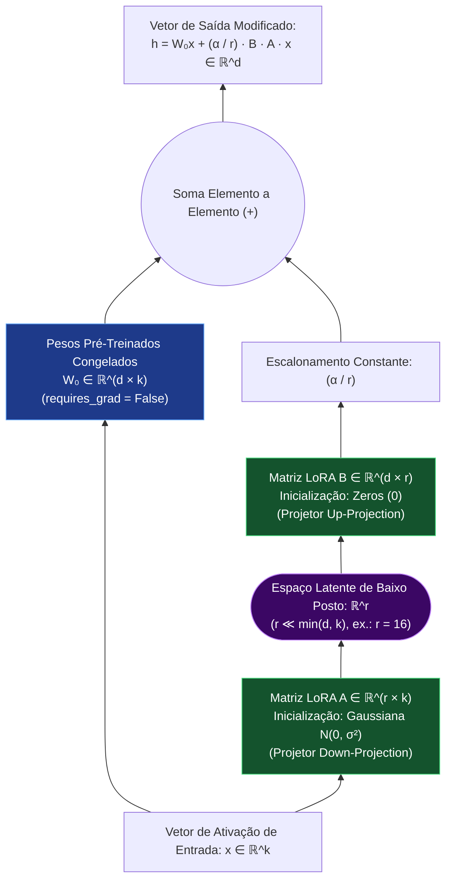

# 05 — LoRA (Low-Rank Adaptation): Engenharia, Matemática e Implementação Prática

**Projeto:** I.See Agents — Multi-Agent AI Platform  
**Módulo:** Engenharia e Treinamento de IA (`docs/ai-training/`) — **Documento Prioritário**  
**Escopo do Documento:** Fundamentação Matemática Completa, Hiperparâmetros, Código Funcional com Hugging Face (`transformers`, `peft`, `trl`) e Ciclo de Vida de Adaptadores em Produção.

---

## 1. Conceito e Motivação Científica do LoRA

Proposto por Hu et al. (2021) no artigo seminal *"LoRA: Low-Rank Adaptation of Large Language Models"*, o **LoRA** parte de uma descoberta fundamental sobre redes neurais sobreparametrizadas (Aghajanyan et al., 2020): embora os modelos de linguagem possuam bilhões de parâmetros distribuídos em matrizes de alta dimensão, **a mudança nos pesos necessária para adaptar o modelo a uma nova tarefa especializada possui uma "dimensão intrínseca" muito baixa (*low intrinsic rank*)**.

Em vez de atualizar diretamente a matriz de pesos original pré-treinada $W_0 \in \mathbb{R}^{d \times k}$, o LoRA **congela completamente $W_0$** (bloqueando o cálculo de gradientes e estados de otimizador sobre ela) e injeta um caminho paralelo composto por duas matrizes menores fatoradas de posto (rank) $r$:



---

## 2. Formulação Matemática Rigorosa

Considere uma camada linear qualquer de um bloco Transformer com matriz de pesos pré-treinada $W_0 \in \mathbb{R}^{d \times k}$. No ajuste fino convencional, os pesos atualizados seriam $W = W_0 + \Delta W$, onde $\Delta W \in \mathbb{R}^{d \times k}$ possui $d \times k$ parâmetros livres.

No **LoRA**, restringimos a atualização $\Delta W$ através de uma decomposição de baixo posto (*Low-Rank Decomposition*):

$$W = W_0 + \Delta W = W_0 + \frac{\alpha}{r} B A$$

Onde:
- $W_0 \in \mathbb{R}^{d \times k}$: Pesos originais congelados (`requires_grad = False`).
- $A \in \mathbb{R}^{r \times k}$: Matriz de projeção de redução (*down-projection*), treinável.
- $B \in \mathbb{R}^{d \times r}$: Matriz de projeção de expansão (*up-projection*), treinável.
- $r \in \mathbb{N}$: O **Rank (Posto)** da decomposição, escolhido tal que $r \ll \min(d, k)$ (tipicamente $r \in \{8, 16, 32, 64\}$, enquanto $d, k \in \{2048, 4096, 8192\}$).
- $\alpha \in \mathbb{R}^+$: Constante de escalonamento (`lora_alpha`).

Para uma entrada $x \in \mathbb{R}^k$, o *forward pass* modificado calcula:

$$h = W_0 x + \frac{\alpha}{r} B(Ax)$$

### 2.1 Por Que $A$ é Inicializada com Ruído Gaussiano e $B$ com Zeros?

No passo inicial do treinamento ($t = 0$):
- $A \sim \mathcal{N}(0, \sigma^2)$ (ou inicialização Kaiming Uniforme).
- $B = \mathbf{0}_{d \times r}$ (matriz nula).

Como consequência imediata, no início do treinamento temos:

$$\Delta W_{t=0} = \frac{\alpha}{r} B_{t=0} A_{t=0} = \mathbf{0}$$

Isso garante uma propriedade matemática crucial: **no exato instante em que o treinamento começa, a rede com LoRA comporta-se de forma 100% idêntica ao modelo base pré-treinado original**, sem introduzir perturbações aleatórias que desestabilizem as ativações das camadas seguintes. (Se ambas $A$ e $B$ fossem inicializadas com zeros, os gradientes seriam nulos em um ponto de sela; se ambas fossem aleatórias, $\Delta W_{t=0} \neq 0$ causaria instabilidade inicial).

### 2.2 Economia Matemática de Parâmetros (Exemplo Concreto)

Seja uma matriz de projeção $W_0$ de dimensão $d = 4096$ por $k = 4096$:
- **Parâmetros na matriz original $W_0$:**
  $$N_{\text{original}} = 4096 \times 4096 = 16.777.216 \text{ parâmetros}$$
- **Parâmetros no adaptador LoRA com rank $r = 16$:**
  $$N_{\text{LoRA}} = (d \times r) + (r \times k) = r(d + k) = 16 \times (4096 + 4096) = 131.072 \text{ parâmetros}$$
- **Taxa de Compressão na Camada:**
  $$\frac{N_{\text{LoRA}}}{N_{\text{original}}} = \frac{131.072}{16.777.216} = 0.0078125 \approx 0.78\%$$

Reduzimos o número de parâmetros treináveis da camada em **$99.22\%$**!

---

## 3. Hiperparâmetros do LoRA: Guia de Engenharia

Ao configurar `LoraConfig` na biblioteca Hugging Face `peft`, cada hiperparâmetro possui um papel físico específico:

### 3.1 `r` (Rank / Posto da Matriz)
Define a dimensão do gargalo intermediário $\mathbb{R}^r$ e a capacidade máxima de informação que o adaptador pode armazenar:
- **`r = 8`:** Extremamente leve. Ideal para ajustes simples de formato de saída (JSON, estilo de resposta, tom de voz).
- **`r = 16` ou `r = 32`:** **Ponto ótimo recomendado (*Sweet Spot*)** para a maioria dos agentes especializados na plataforma I.See Agents. Equilibra expressividade de domínio e baixo risco de overfitting.
- **`r = 64` ou `r = 128`:** Indicado apenas quando o dataset é amplo ($> 20.000$ exemplos) e a tarefa exige aprendizado de sintaxes complexas ou múltiplos domínios simultâneos.

### 3.2 `lora_alpha` ($\alpha$ — Fator de Escala)
Controla a intensidade com que as ativações do adaptador ($BAx$) são somadas às ativações do modelo base ($W_0x$) através do multiplicador $\frac{\alpha}{r}$.
- **Padrão de Engenharia:** Definir $\alpha = 2 \times r$ (ex.: se `r = 16`, usar `lora_alpha = 32`) ou $\alpha = r$ (ex.: `r = 16, lora_alpha = 16`).
- **Por que existe $\frac{\alpha}{r}$?** Isso desacopla a escolha do rank $r$ da necessidade de reajustar drasticamente o `learning_rate` sempre que você altera $r$ em experimentos.

### 3.3 `target_modules` (Seleção de Camadas Alvo no Transformer)
Onde devemos aplicar adaptadores LoRA dentro de cada bloco Decoder Transformer?
- **Bloco de Autoatenção (Self-Attention):**
  - `q_proj` ($W_Q$): Projeção de Query.
  - `k_proj` ($W_K$): Projeção de Key.
  - `v_proj` ($W_V$): Projeção de Value.
  - `o_proj` ($W_O$): Projeção de saída da atenção multi-cabeça.
- **Bloco MLP / Feed-Forward (SwiGLU em Llama/Qwen/Mistral):**
  - `gate_proj`: Projeção de porta de ativação.
  - `up_proj`: Expansão da dimensão oculta para dimensão intermediária.
  - `down_proj`: Redução de volta para $d_{\text{model}}$.

> **Evidência Empírica (Dettmers et al., 2023):** Aplicar LoRA em **todas as camadas lineares** (`q_proj`, `k_proj`, `v_proj`, `o_proj`, `gate_proj`, `up_proj`, `down_proj`) produz qualidade significativamente superior a aplicar apenas em `q_proj` e `v_proj`, mesmo que se utilize um rank $r$ ligeiramente menor.

### 3.4 `lora_dropout` e `bias`
- **`lora_dropout`:** Probabilidade de zerar aleatoriamente elementos na entrada do ramo LoRA durante o treino (tipicamente `0.05` ou `0.10`), atuando como regularizador contra *overfitting*.
- **`bias`:** Geralmente configurado como `"none"` para manter os vetores de bias originais congelados e preservar máxima portabilidade do adaptador.

---

## 4. Código Completo e Reproduzível: Treinamento, Salvamento, Inferência e Merge

O código abaixo utiliza a stack oficial moderna (**PyTorch**, **Hugging Face `transformers`**, **`peft`**, **`datasets`** e **`trl`**) e reflete exatamente a estrutura implementada no laboratório `ml/` da plataforma I.See Agents.

### 4.1 Treinamento de Adaptador LoRA (`SFTTrainer` + `PEFT`)

```python
import os
import torch
from datasets import load_dataset
from transformers import (
    AutoModelForCausalLM,
    AutoTokenizer,
    TrainingArguments,
)
from peft import LoraConfig, TaskType, get_peft_model
from trl import SFTTrainer

def train_agent_lora_adapter(
    base_model_id: str = "Qwen/Qwen2.5-0.5B-Instruct",
    dataset_path: str = "ml/datasets/sample_agent_sft.jsonl",
    output_dir: str = "ml/artifacts/adapters/isee_agent_lora_v1",
    lora_r: int = 16,
    lora_alpha: int = 32,
    lora_dropout: float = 0.05,
    num_epochs: int = 3,
    learning_rate: float = 2e-4,
) -> None:
    """
    Pipeline completo de Supervised Fine-Tuning (SFT) com LoRA.
    Mantém os pesos do modelo base 100% congelados e salva apenas os tensores A e B.
    """
    device = "cuda" if torch.cuda.is_available() else "cpu"
    compute_dtype = (
        torch.bfloat16
        if (device == "cuda" and torch.cuda.is_bf16_supported())
        else (torch.float16 if device == "cuda" else torch.float32)
    )

    print(f"[I.See ML Lab] Inicializando treinamento LoRA em {device.upper()} ({compute_dtype})")

    # 1. Carregar Tokenizador e garantir pad_token válido
    tokenizer = AutoTokenizer.from_pretrained(base_model_id, trust_remote_code=True)
    if tokenizer.pad_token is None:
        tokenizer.pad_token = tokenizer.eos_token
    tokenizer.padding_side = "right"

    # 2. Carregar Modelo Base
    model = AutoModelForCausalLM.from_pretrained(
        base_model_id,
        torch_dtype=compute_dtype,
        device_map="auto" if device == "cuda" else None,
        trust_remote_code=True,
    )
    model.config.use_cache = False  # Desabilitado durante treino para compatibilidade com gradient checkpointing

    # 3. Configurar Arquitetura LoRA (Low-Rank Adaptation)
    peft_config = LoraConfig(
        task_type=TaskType.CAUSAL_LM,
        r=lora_r,
        lora_alpha=lora_alpha,
        lora_dropout=lora_dropout,
        bias="none",
        target_modules=[
            "q_proj", "k_proj", "v_proj", "o_proj",
            "gate_proj", "up_proj", "down_proj",
        ],
    )

    model = get_peft_model(model, peft_config)
    model.print_trainable_parameters()
    # Exemplo de saída esperada:
    # trainable params: 8,798,208 || all params: 502,830,976 || trainable%: 1.7497%

    # 4. Carregar Dataset JSONL (campos: system, instruction, input, output)
    dataset = load_dataset("json", data_files=dataset_path, split="train")
    split_dataset = dataset.train_test_split(test_size=0.15, seed=42)

    def format_chat_example(example: dict) -> dict:
        user_content = example["instruction"]
        if example.get("input"):
            user_content += f"\n\nContexto/Entrada:\n{example['input']}"
        messages = [
            {"role": "system", "content": example.get("system", "Você é um agente especialista da plataforma I.See Agents.")},
            {"role": "user", "content": user_content},
            {"role": "assistant", "content": example["output"]},
        ]
        formatted_text = tokenizer.apply_chat_template(
            messages, tokenize=False, add_generation_prompt=False
        )
        return {"text": formatted_text}

    train_data = split_dataset["train"].map(format_chat_example)
    eval_data = split_dataset["test"].map(format_chat_example)

    # 5. Hiperparâmetros de Treinamento
    training_args = TrainingArguments(
        output_dir=output_dir,
        num_train_epochs=num_epochs,
        per_device_train_batch_size=2,
        gradient_accumulation_steps=4,
        learning_rate=learning_rate,
        weight_decay=0.01,
        warmup_ratio=0.1,
        lr_scheduler_type="cosine",
        logging_steps=5,
        eval_strategy="steps",
        eval_steps=20,
        save_strategy="steps",
        save_steps=20,
        save_total_limit=2,
        bf16=(compute_dtype == torch.bfloat16),
        fp16=(compute_dtype == torch.float16),
        report_to="none",
        seed=42,
    )

    trainer = SFTTrainer(
        model=model,
        train_dataset=train_data,
        eval_dataset=eval_data,
        processing_class=tokenizer,
        args=training_args,
    )

    # 6. Executar Treinamento e Salvar Apenas o Adaptador LoRA
    trainer.train()
    os.makedirs(output_dir, exist_ok=True)
    trainer.model.save_pretrained(output_dir)
    tokenizer.save_pretrained(output_dir)
    print(f"[I.See ML Lab] Adaptador salvo com sucesso em: {output_dir}")
```

### 4.2 Estrutura dos Artefatos Gerados em Disco

Ao executar `trainer.model.save_pretrained(output_dir)`, o PEFT **não salva** os gigabytes do modelo base $W_0$. Ele gera apenas:
1. `adapter_config.json`: Metadados contendo `base_model_name_or_path`, `r`, `lora_alpha`, `target_modules` e `peft_type: "LORA"`.
2. `adapter_model.safetensors`: Tensores binários seguros contendo exclusivamente as matrizes treinadas `lora_A.weight` e `lora_B.weight` de cada camada alvo.

### 4.3 Carregamento em Produção e Fusão Matemática (`merge_and_unload`)

Durante a inferência, existem duas formas de operar o adaptador:

1. **Modo Dinâmico Multi-Agente (`PeftModel.from_pretrained`):** Mantém $W_0$ separado de $BA$. Ideal quando múltiplos agentes na plataforma I.See Agents compartilham o mesmo modelo base e alternam adaptadores em tempo de execução.
2. **Modo Fundido sem Overhead (`merge_and_unload()`):** Calcula algebricamente $W_{\text{merged}} = W_0 + \frac{\alpha}{r}BA$ e descarta os ramos paralelos, resultando em **latência adicional zero** em relação ao modelo base original:

```python
import torch
from transformers import AutoModelForCausalLM, AutoTokenizer
from peft import PeftModel

def load_and_run_lora_adapter(
    base_model_id: str,
    adapter_dir: str,
    prompt: str,
    merge_weights: bool = False,
) -> str:
    tokenizer = AutoTokenizer.from_pretrained(base_model_id)
    base_model = AutoModelForCausalLM.from_pretrained(
        base_model_id,
        torch_dtype=torch.float16 if torch.cuda.is_available() else torch.float32,
        device_map="auto" if torch.cuda.is_available() else None,
    )

    # Acopla os tensores A e B do adaptador sobre o modelo base congelado
    peft_model = PeftModel.from_pretrained(base_model, adapter_dir)

    if merge_weights:
        # Funde W = W_0 + (alpha/r) * B @ A permanentemente em memória para latência zero
        model = peft_model.merge_and_unload()
    else:
        model = peft_model

    model.eval()
    messages = [{"role": "user", "content": prompt}]
    inputs = tokenizer.apply_chat_template(
        messages, add_generation_prompt=True, return_tensors="pt"
    ).to(model.device)

    with torch.no_grad():
        outputs = model.generate(
            inputs,
            max_new_tokens=256,
            temperature=0.2,
            top_p=0.9,
            do_sample=True,
        )

    response_tokens = outputs[0][inputs.shape[-1]:]
    return tokenizer.decode(response_tokens, skip_special_tokens=True)
```

---

## 5. Vantagens Reais e Limitações do LoRA em Produção

| Vantagens Reais em Produção | Limitações Técnicas e Cuidados |
| :--- | :--- |
| **Economia Extrema de Armazenamento:** 12 agentes especializados podem ter 12 adaptadores LoRA distintos ocupando menos de $500\text{ MB}$ no total, compartilhando um único modelo base. | **Dependência Estrita do Modelo Base:** Um adaptador treinado sobre `Qwen2.5-3B-Instruct` é matematicamente incompatível com `Llama-3.2-3B-Instruct` (dimensões e espaços latentes distintos). |
| **Zero Latência Adicional (após Merge):** Como a operação $W_0 + \frac{\alpha}{r}BA$ é linear, ela pode ser pré-computada na carga do modelo ou exportada para GGUF no Ollama. | **Não Substitui o RAG para Fatos Voláteis:** Tentar usar LoRA para ensinar catálogos de preços ou documentos diários causa alucinações; use LoRA para *comportamento/formato* e RAG para *conhecimento factual*. |
| **Reversibilidade e Segurança:** Se um adaptador apresentar regressão, basta desabilitar a flag `lora_adapter.enabled` no JSON do agente para retornar instantaneamente ao modelo base. | **Capacidade Limitada pelo Rank $r$:** Tarefas que exigem aprender um idioma inteiramente novo do zero superam a capacidade de subespaços de posto muito baixo ($r \le 8$). |
