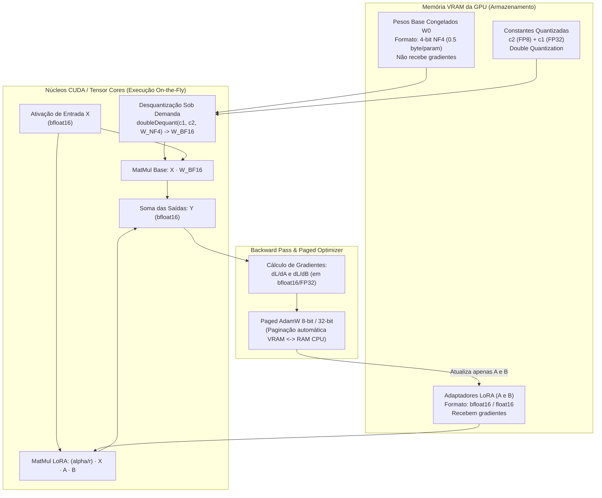

# 06. QLoRA — Quantized Low-Rank Adaptation em Profundidade

**Projeto:** I.See Agents — Multi-Agent AI Platform  
**Autor:** Júlio César | **Organização:** I.See Technologies (`https://iseetechnologies.com.br/`)  
**Repositório:** `securityMaker488/isee-agents`  
**Escopo do Documento:** Documentação técnica e educacional de engenharia sobre QLoRA (*Quantized Low-Rank Adaptation*), detalhando fundamentos matemáticos, quantização NF4, Double Quantization, Paged Optimizers, fluxo de precisão mista e integração com o ecossistema Hugging Face (`bitsandbytes`, `transformers`, `peft`, `trl`) no diretório `ml/experiments/train_qlora.py`.

---

## 1. Visão Geral e Motivação de Engenharia

Enquanto o **LoRA (Low-Rank Adaptation)** tradicional reduz drasticamente o custo de memória dos gradientes e estados do otimizador (AdamW) ao congelar o modelo base e treinar apenas matrizes de posto baixo $A$ e $B$, os pesos congelados $W_0$ do modelo base ainda precisam residir na VRAM em `float16` ou `bfloat16` (2 bytes por parâmetro). Para um modelo de 8 bilhões de parâmetros (ex.: Llama-3-8B ou Qwen2.5-7B), somente os pesos base consomem ~15 a 16 GB de VRAM antes mesmo de alocar ativações ou KV Cache.

O **QLoRA** (*Dettmers et al., 2023*) resolve esse gargalo introduzindo três inovações fundamentais que permitem ajustar modelos de 7B/8B em GPUs de 6 GB a 8 GB de VRAM e modelos de 65B/70B em uma única GPU de 48 GB sem perda significativa de desempenho em relação ao ajuste fino em 16 bits:

1. **4-bit NormalFloat (NF4):** Um tipo de dado quantizado em 4 bits que é teoricamente ótimo do ponto de vista da teoria da informação para pesos de redes neurais pré-treinadas que seguem uma distribuição normal centrada em zero.
2. **Double Quantization (Quantização Dupla):** O processo de quantizar as próprias constantes de quantização ($c_2^{\text{FP32}}$) para 8 bits, reduzindo o overhead de memória por parâmetro de 0,5 bits para ~0,127 bits.
3. **Paged Optimizers (Otimizadores Paginados):** Uso do recurso de memória unificada (*Unified Memory*) do NVIDIA CUDA para transferir automaticamente páginas dos estados do otimizador entre a VRAM da GPU e a RAM da CPU durante picos de memória causados por sequências longas (*activation spikes*), evitando erros de `CUDA Out of Memory (OOM)`.

> [!IMPORTANT]
> **Distinção Arquitetural no I.See Agents:**
> - **Funcionalidade Integrada (`ml/experiments/train_qlora.py`):** Script completo e reproduzível de treinamento QLoRA com detecção automática de hardware CUDA e fallback transparente para validação estrutural em CPU.
> - **Treinamento Pesado em GPU:** Quando executado em ambiente Linux com GPU NVIDIA compatível, o script ativa nativamente `BitsAndBytesConfig` em 4 bits (`nf4`) com Double Quantization e `paged_adamw_8bit`.

---

## 2. Fundamentos Matemáticos do QLoRA

### 2.1 Quantização por Blocos (*Block-wise k-bit Quantization*)

Na quantização padrão de ponto flutuante para inteiros de $k$ bits, um tensor de pesos $W$ é dividido em blocos independentes e contíguos de tamanho $B$ (no QLoRA, tipicamente $B = 64$) para isolar *outliers* (valores extremos que distorceriam toda a escala se um único fator fosse usado para a matriz inteira).

Para um bloco $W_b$, a constante de quantização (fator de escala absoluto máximo, ou *absmax*) $c_b$ é calculada como:

$$c_b = \max(|W_b|)$$

No caso do **NF4 (4-bit NormalFloat)**, aproveita-se a propriedade estatística de que os pesos de camadas lineares em Transformers pré-treinados seguem uma distribuição normal $\mathcal{N}(0, \sigma^2)$. Os $2^4 = 16$ níveis de quantização $q_i \in [-1, 1]$ são estimados usando os quantis exatos da distribuição normal padrão $\mathcal{N}(0, 1)$, garantindo que cada um dos 16 *bins* de quantização contenha o mesmo número esperado de pesos:

$$q_i = \frac{1}{2} \left( Q_X\left(\frac{i}{16 + 1}\right) + Q_X\left(\frac{i + 1}{16 + 1}\right) \right)$$

onde $Q_X(\cdot)$ é a função quantil da distribuição normal padrão, normalizada assimetricamente no intervalo $[-1, 1]$ para garantir a representação exata do zero ($0.0$).

### 2.2 Double Quantization (Quantização Dupla)

Armazenar uma constante de escala $c_2^{\text{FP32}}$ de 32 bits para cada bloco de $B = 64$ pesos adiciona um custo extra de:

$$\frac{32 \text{ bits}}{64 \text{ parâmetros}} = 0.5 \text{ bits por parâmetro}$$

A **Double Quantization** aplica uma segunda etapa de quantização sobre o vetor de constantes $c_2^{\text{FP32}}$, agrupando-as em blocos de tamanho $B_2 = 256$ e quantizando-as em 8 bits (`FP8` positivo), gerando constantes quantizadas $c_2^{\text{FP8}}$ e constantes de segundo nível $c_1^{\text{FP32}}$:

$$\text{Overhead com Double Quantization} = \frac{8}{64} + \frac{32}{64 \times 256} = 0.125 + 0.00195 \approx 0.127 \text{ bits por parâmetro}$$

Isso economiza **0,373 bits por parâmetro** (~3 GB de VRAM em um modelo de 65B/70B parâmetros, ou ~380 MB em um modelo de 8B).

---

## 3. Fluxo de Precisão Mista (4-bit Armazenamento vs. 16-bit Computação)

Um erro conceitual comum é achar que a multiplicação de matrizes no QLoRA ocorre diretamente em 4 bits. Na realidade, **4-bit NF4 é exclusivamente um formato de armazenamento em memória**. Toda a aritmética de ponto flutuante durante o *forward pass* e o *backward pass* ocorre em `bfloat16` (ou `float16`).

Para uma camada linear com entrada $X^{\text{BF16}}$, pesos base quantizados $W^{\text{NF4}}$ e adaptadores LoRA treináveis $A^{\text{BF16}}$ e $B^{\text{BF16}}$, a saída $Y^{\text{BF16}}$ é definida por:

$$Y^{\text{BF16}} = X^{\text{BF16}} \cdot \text{doubleDequant}\left(c_1^{\text{FP32}}, c_2^{\text{k-bit}}, W^{\text{NF4}}\right) + \frac{\alpha}{r} X^{\text{BF16}} A^{\text{BF16}} B^{\text{BF16}}$$

onde a desquantização dupla ocorre sob demanda nos registradores da GPU apenas para a camada em execução e é descartada imediatamente após a operação:

$$\text{doubleDequant}\left(c_1^{\text{FP32}}, c_2^{\text{k-bit}}, W^{\text{NF4}}\right) = \text{dequant}\left(\text{dequant}\left(c_1^{\text{FP32}}, c_2^{\text{k-bit}}\right), W^{\text{NF4}}\right) = W^{\text{BF16}}$$

### Diagrama do Fluxo Computacional do QLoRA



---

## 4. Integração Completa: `bitsandbytes`, `transformers`, `peft` e `trl`

No repositório do **I.See Agents**, a implementação oficial encontra-se em [`ml/experiments/train_qlora.py`](file:///C:/Users/golde/.gemini/antigravity/scratch/isee-agents/ml/experiments/train_qlora.py). Abaixo detalhamos cada etapa crítica da integração.

### 4.1 Configuração do `BitsAndBytesConfig`

```python
import torch
from transformers import AutoModelForCausalLM, AutoTokenizer, BitsAndBytesConfig
from peft import LoraConfig, get_peft_model, prepare_model_for_kbit_training
from trl import SFTConfig, SFTTrainer

# Determina se a GPU suporta bfloat16 nativamente (NVIDIA Ampere RTX 30xx / A100 ou superior)
compute_dtype = (
    torch.bfloat16
    if torch.cuda.is_available() and torch.cuda.is_bf16_supported()
    else torch.float16
)

bnb_config = BitsAndBytesConfig(
    load_in_4bit=True,                      # Ativa carregamento quantizado em 4 bits
    bnb_4bit_quant_type="nf4",              # NormalFloat 4-bit (ótimo para pesos normais)
    bnb_4bit_use_double_quant=True,         # Quantiza as constantes de quantização (economiza ~0.37 bits/param)
    bnb_4bit_compute_dtype=compute_dtype,   # Desquantiza sob demanda para bfloat16/float16 no forward/backward
)
```

### 4.2 Preparação do Modelo com `prepare_model_for_kbit_training`

Antes de injetar os adaptadores LoRA em um modelo quantizado em 4 bits, é obrigatório executar `prepare_model_for_kbit_training`. Essa função realiza quatro operações essenciais de estabilidade numérica:
1. Congela todos os parâmetros do modelo base (`param.requires_grad = False`).
2. Converte todas as camadas de normalização (`LayerNorm` / `RMSNorm`) e o cabeçalho de linguagem (`lm_head`) para `float32` a fim de evitar *underflow* ou *overflow* durante o cálculo de gradientes.
3. Ativa o **Gradient Checkpointing** (`model.gradient_checkpointing_enable()`), descartando ativações intermediárias no *forward pass* e recalculando-as no *backward pass*, reduzindo drasticamente o consumo de VRAM para sequências longas.
4. Habilita `enable_input_require_grads()` nos embeddings de entrada para que o grafo de autograd do PyTorch propague gradientes através das camadas quantizadas congeladas até os adaptadores LoRA iniciais.

```python
model = AutoModelForCausalLM.from_pretrained(
    "Qwen/Qwen2.5-7B-Instruct",
    quantization_config=bnb_config,
    device_map="auto",
    trust_remote_code=False,
)

# Prepara LayerNorms em FP32 e ativa Gradient Checkpointing
model = prepare_model_for_kbit_training(
    model,
    use_gradient_checkpointing=True,
)
```

### 4.3 Configuração do `LoraConfig` em Todas as Projeções Lineares

O artigo original do QLoRA (*Dettmers et al., 2023*) demonstra empiricamente que, para igualar a qualidade do Full Fine-Tuning em 16 bits, **o QLoRA deve ser aplicado a todas as camadas lineares do Transformer** (Atenção + MLP SwiGLU), e não apenas em `q_proj` e `v_proj`:

```python
lora_config = LoraConfig(
    r=16,                                   # Posto (rank) das matrizes A e B
    lora_alpha=32,                          # Fator de escala (tipicamente 2 * r)
    lora_dropout=0.05,                      # Regularização nos adaptadores
    bias="none",                            # Não treina termos de bias
    task_type="CAUSAL_LM",
    target_modules=[
        "q_proj", "k_proj", "v_proj", "o_proj",  # Projeções de Self-Attention
        "gate_proj", "up_proj", "down_proj",     # Projeções da FFN (SwiGLU MLP)
    ],
)

model = get_peft_model(model, lora_config)
model.print_trainable_parameters()
```

### 4.4 Treinamento Supervisionado com `SFTTrainer` e Paged Optimizers

```python
sft_config = SFTConfig(
    output_dir="ml/outputs/qlora-isee-agent",
    num_train_epochs=3,
    per_device_train_batch_size=2,
    gradient_accumulation_steps=8,          # Batch efetivo = 2 * 8 = 16
    learning_rate=2e-4,
    lr_scheduler_type="cosine",
    warmup_ratio=0.05,
    optim="paged_adamw_8bit",               # Paged Optimizer do bitsandbytes
    bf16=torch.cuda.is_bf16_supported(),
    fp16=not torch.cuda.is_bf16_supported(),
    max_grad_norm=0.3,                      # Gradient clipping recomendado no artigo QLoRA
    weight_decay=0.01,
    logging_steps=10,
    save_strategy="epoch",
    dataset_text_field="text",
    max_seq_length=2048,
)
```

---

## 5. Comparativo Real de Consumo de Memória VRAM

A tabela abaixo apresenta a decomposição teórica e prática de consumo de VRAM para um modelo de **7B a 8B de parâmetros** (ex.: Qwen2.5-7B-Instruct ou Llama-3.1-8B-Instruct) com comprimento de sequência de `2048` tokens, *batch size* por dispositivo igual a `1` e *Gradient Checkpointing* ativado:

| Componente de Memória | Full Fine-Tuning (BF16 + AdamW FP32) | LoRA 16-bit (BF16 + `r=16`) | QLoRA 4-bit (NF4 + DQ + Paged AdamW 8-bit) |
| :--- | :--- | :--- | :--- |
| **Pesos do Modelo Base ($W_0$)** | ~15.0 GB (2 bytes/param) | ~15.0 GB (2 bytes/param) | **~4.1 GB** (~0.516 bytes/param) |
| **Pesos Treináveis ($\Delta W$)** | Inclusos em $W_0$ | ~0.08 GB (~40M params em BF16) | **~0.08 GB** (~40M params em BF16) |
| **Gradientes** | ~15.0 GB (BF16) | ~0.08 GB (apenas $A$ e $B$) | **~0.08 GB** (apenas $A$ e $B$) |
| **Estados do Otimizador** | ~60.0 GB (FP32 master + $m$ + $v$) | ~0.32 GB (AdamW FP32 em $A, B$) | **~0.08 GB** (Paged AdamW 8-bit) |
| **Ativações + KV Cache + CUDA Context** | ~8.0 – 12.0 GB | ~2.5 – 4.0 GB | **~1.8 – 3.2 GB** |
| **VRAM Total Estimada** | **~98 GB – 102 GB** (Exige 2x A100 80GB) | **~18 GB – 19.5 GB** (Exige RTX 3090/4090 24GB) | **~6.2 GB – 7.5 GB** (Roda em RTX 3060/4060 8GB/12GB) |

---

## 6. Compatibilidade de Hardware e Sistema Operacional (Linux vs. Windows)

O funcionamento da biblioteca `bitsandbytes` depende de *kernels* CUDA compilados nativamente (`libbitsandbytes_cuda*.so` / `.dll`) para realizar a desquantização rápida de blocos NF4 e a paginação via memória unificada CUDA.

| Ambiente / Hardware | Suporte a `bitsandbytes` 4-bit NF4 | Suporte a `bfloat16` | Recomendação de Engenharia no I.See Agents |
| :--- | :--- | :--- | :--- |
| **Debian/Ubuntu Linux + GPU NVIDIA Ampere/Ada/Hopper (RTX 30xx, 40xx, A10, L4, A100)** | Nativo e total | Sim (`torch.bfloat16`) | **Ambiente Recomendado de Produção/Treino:** Estabilidade máxima de `paged_adamw_8bit` e `nf4`. |
| **Debian/Ubuntu Linux + GPU NVIDIA Turing (RTX 20xx, T4)** | Nativo e total | Não (usar `torch.float16`) | Totalmente suportado; definir `bnb_4bit_compute_dtype=torch.float16` e `fp16=True`. |
| **Windows 10/11 Nativo + GPU NVIDIA** | Suportado em `bitsandbytes >= 0.43.0` | Depende da geração da GPU | Funcional para desenvolvimento local; para treinos longos com *Paged Optimizers*, prefira **WSL2 (Ubuntu/Debian)** ou servidor Linux dedicado. |
| **Ambiente Somente CPU (Sem GPU NVIDIA)** | Não aplicável para aceleração 4-bit | Emulado via CPU (`float32`) | O script [`ml/experiments/train_qlora.py`](file:///C:/Users/golde/.gemini/antigravity/scratch/isee-agents/ml/experiments/train_qlora.py) detecta automaticamente a ausência de CUDA e executa o modo de **validação estrutural do pipeline** em CPU com micro-modelo, garantindo que a engenharia de código seja testável em qualquer máquina. |

### Como Executar o Pipeline QLoRA no Repositório

```bash
# 1. Em máquina com GPU NVIDIA (Treinamento QLoRA 4-bit NF4 real)
python ml/experiments/train_qlora.py \
  --model-name Qwen/Qwen2.5-3B-Instruct \
  --dataset-path ml/datasets/processed/train.jsonl \
  --eval-dataset-path ml/datasets/processed/val.jsonl \
  --output-dir ml/outputs/qlora-qwen25-3b \
  --epochs 3 \
  --batch-size 2 \
  --grad-accum 8 \
  --lora-r 16 \
  --lora-alpha 32

# 2. Em máquina sem GPU dedicada (Modo de verificação de integridade do pipeline)
python ml/experiments/train_qlora.py --smoke-test
```
