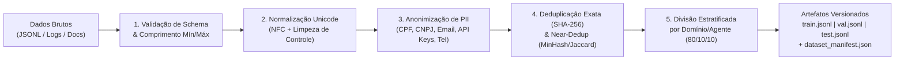

# 07. Engenharia de Datasets para Agentes Especializados

**Projeto:** I.See Agents — Multi-Agent AI Platform  
**Autor:** Júlio César | **Organização:** I.See Technologies (`https://iseetechnologies.com.br/`)  
**Repositório:** `securityMaker488/isee-agents`  
**Escopo do Documento:** Guia completo de engenharia de dados para ajuste fino supervisionado (SFT) e alinhamento de agentes: coleta autorizada, formatação instrucional e multi-turno (ChatML / Messages JSONL), limpeza e normalização Unicode, deduplicação exata e semântica, anonimização de PII (LGPD), divisão estratificada sem *data leakage* e versionamento reproduzível.

---

## 1. Princípios de Qualidade de Dados (*Data-Centric AI*)

No treinamento de LLMs modernos com LoRA e QLoRA (como demonstrado nos estudos *LIMA: Less Is More for Alignment*), **a qualidade, diversidade e consistência estrutural dos exemplos superam o volume bruto**. Um conjunto de 500 a 2.000 exemplos rigorosamente curados, livres de contradições e alinhados ao domínio produz agentes significativamente mais confiáveis do que dezenas de milhares de registros ruidosos.

> [!IMPORTANT]
> **Status no Repositório (`ml/datasets/`):**
> - **Funcionalidade Integrada e Executável:** O repositório inclui o dataset semente [`ml/datasets/synthetic_agents.jsonl`](file:///C:/Users/golde/.gemini/antigravity/scratch/isee-agents/ml/datasets/synthetic_agents.jsonl) e o pipeline de preparação [`ml/datasets/prepare_dataset.py`](file:///C:/Users/golde/.gemini/antigravity/scratch/isee-agents/ml/datasets/prepare_dataset.py), que realiza validação de esquema, normalização Unicode, sanitização de PII, deduplicação SHA-256 e divisão determinística (`train.jsonl`, `val.jsonl`, `test.jsonl`).
> - **Expansão Corporativa (Trabalho Contínuo):** A ingestão de logs reais de atendimento e bases documentais específicas de clientes deve passar obrigatoriamente por este mesmo pipeline antes de qualquer ciclo de treinamento.

---

## 2. Coleta Autorizada e Governança de Dados

Toda coleta de dados para especialização de agentes na I.See Technologies segue quatro diretrizes obrigatórias:

1. **Conformidade Legal e Contratual (LGPD - Lei nº 13.709/2018):** Apenas documentos, tickets técnicos, manuais operacionais e interações cujo uso para melhoria de modelos internos esteja expressamente autorizado são elegíveis.
2. **Proibição de Credenciais e Segredos:** Nenhum log bruto contendo tokens JWT, senhas, chaves SSH ou strings de conexão de banco de dados pode ingressar no repositório de treinamento.
3. **Verificação de Licença de Datasets Públicos:** Caso sejam incorporados datasets abertos de suporte (ex.: instruções em português), a licença deve ser permissiva para uso comercial (`Apache-2.0`, `MIT`, `CC-BY-4.0`), evitando datasets gerados sob termos restritivos que proíbam uso comercial.
4. **Rastreabilidade de Origem (*Provenance*):** Cada registro no JSONL carrega metadados de domínio (`domain`), agente alvo (`agent_slug`) e fonte (`source`), permitindo auditoria e remoção seletiva (*machine unlearning* / *dataset pruning*).

---

## 3. Estruturação e Formatos de Dataset

### 3.1 Formato Padrão de Instrução (`Instruction / Input / Output`)

Ideal para tarefas diretas de transformação, análise estática, classificação ou geração de relatórios técnicos:

```json
{
  "id": "sec-001",
  "agent_slug": "cybersecurity-analyst",
  "domain": "security",
  "system": "Você é um Engenheiro de Segurança da I.See Technologies especializado em aplicação web e conformidade OWASP Top 10.",
  "instruction": "Analise o trecho de código FastAPI abaixo e identifique vulnerabilidades de injeção SQL, propondo a correção segura com SQLAlchemy ORM.",
  "input": "query = f\"SELECT * FROM users WHERE email = '{user_email}'\"\ndb.execute(text(query))",
  "output": "### Vulnerabilidade Identificada: SQL Injection (CWE-89)\nO uso de f-strings concatena diretamente a entrada do usuário na instrução SQL...\n\n### Correção Recomendada\n```python\nstmt = select(User).where(User.email == user_email)\nresult = await db.execute(stmt)\n```"
}
```

### 3.2 Formato Conversacional Multi-Turno (`Messages` / ChatML)

Para agentes interativos do I.See Agents que precisam manter contexto ao longo de múltiplos turnos, recusar solicitações fora de escopo e seguir instruções de sistema estritas, convertemos os registros para a estrutura padrão `messages` compatível com `tokenizer.apply_chat_template()` da Hugging Face e `trl.SFTTrainer`:

```json
{
  "id": "arch-014",
  "agent_slug": "software-architect",
  "domain": "architecture",
  "messages": [
    {
      "role": "system",
      "content": "Você é o Agente Arquiteto de Software da I.See Technologies. Responda em português com rigor técnico, diagramas Mermaid quando aplicável e foco em escalabilidade, segurança e manutenibilidade."
    },
    {
      "role": "user",
      "content": "Precisamos isolar os documentos enviados por cada usuário no RAG usando PostgreSQL e pgvector. Qual é a melhor abordagem?"
    },
    {
      "role": "assistant",
      "content": "Para garantir isolamento multi-tenant estrito no `pgvector`, implemente filtragem obrigatória por chaves estrangeiras (`user_id` e `agent_id`) diretamente na cláusula `WHERE` antes ou durante o cálculo de distância cosseno (`<=>`), combinada com índices compostos B-Tree + HNSW..."
    }
  ]
}
```

---

## 4. Pipeline de Limpeza, Normalização, Deduplicação e Anonimização

O pipeline de engenharia de dados implementado em [`ml/datasets/prepare_dataset.py`](file:///C:/Users/golde/.gemini/antigravity/scratch/isee-agents/ml/datasets/prepare_dataset.py) executa uma sequência determinística de transformações:



### 4.1 Limpeza e Normalização Unicode

Textos extraídos de PDFs, páginas web ou sistemas legados frequentemente contêm caracteres invisíveis (`\u200b` zero-width space), quebras de linha inconsistentes (`\r\n`) e caracteres acentuados decompostos (`NFD`, onde `ã` é separado em `a` + `~`, fragmentando tokens no tokenizador BPE).

1. **Normalização `NFC` (*Normalization Form Canonical Composition*):** Garante que caracteres acentuados do português sejam representados como codepoints canônicos únicos, economizando tokens e estabilizando os embeddings.
2. **Remoção de Caracteres de Controle:** Elimina bytes nulos e caracteres não imprimíveis, preservando apenas `\n` e `\t`.
3. **Colapso de Espaços Múltiplos:** Evita desperdício da janela de contexto sem alterar blocos de código indentados.

### 4.2 Anonimização e Remoção de PII (Proteção de Dados)

Nenhum dado pessoal identificável deve ser memorizado pelos pesos dos adaptadores LoRA. O módulo de sanitização substitui padrões sensíveis por marcadores semânticos padronizados que preservam a estrutura gramatical da frase:

| Tipo de Dado Sensível (PII / Segredo) | Padrão Detectado | Token de Substituição |
| :--- | :--- | :--- |
| **CPF** | `\b\d{3}\.?\d{3}\.?\d{3}-?\d{2}\b` | `[CPF_REDACTED]` |
| **CNPJ** | `\b\d{2}\.?\d{3}\.?\d{3}/?\d{4}-?\d{2}\b` | `[CNPJ_REDACTED]` |
| **E-mail** | `\b[A-Za-z0-9._%+-]+@[A-Za-z0-9.-]+\.[A-Z|a-z]{2,}\b` | `[EMAIL_REDACTED]` |
| **Telefone (BR)** | `\b(?:\+55\s?)?(?:\(?\d{2}\)?\s?)?(?:9\d{4}|\d{4})-?\d{4}\b` | `[PHONE_REDACTED]` |
| **Chaves de API / Bearer Tokens** | `(?:sk-[a-zA-Z0-9]{20,}\|Bearer\s+[a-zA-Z0-9\-._~+/]+=*)` | `[SECRET_KEY_REDACTED]` |
| **Endereços IPv4 Privados/Públicos** | `\b(?:\d{1,3}\.){3}\d{1,3}\b` (quando aplicável) | `[IP_REDACTED]` |

### 4.3 Deduplicação Exata e Semântica

Exemplos duplicados causam *overfitting* severo, forçando o modelo a memorizar respostas palavra por palavra e degradando a capacidade de generalização:

1. **Deduplicação Exata (Hash Criptográfico):** Calcula-se o hash `SHA-256` sobre a tupla canônica `(instruction_normalizada, input_normalizado)` em letras minúsculas e sem pontuação redundante. Registros com mesmo hash são descartados imediatamente.
2. **Deduplicação Quase-Exata (*Near-Deduplication* via Shingling / Jaccard):** Calcula-se a similaridade de Jaccard sobre *n-grams* de palavras ($n=3$). Se dois prompts apresentam similaridade $J(A, B) \ge 0.85$, apenas o exemplo com resposta mais completa e verificada é mantido.

```python
import hashlib
import re
import unicodedata

PII_PATTERNS = [
    (re.compile(r"\b\d{3}\.?\d{3}\.?\d{3}-?\d{2}\b"), "[CPF_REDACTED]"),
    (re.compile(r"\b\d{2}\.?\d{3}\.?\d{3}/?\d{4}-?\d{2}\b"), "[CNPJ_REDACTED]"),
    (re.compile(r"\b[A-Za-z0-9._%+-]+@[A-Za-z0-9.-]+\.[A-Za-z]{2,}\b"), "[EMAIL_REDACTED]"),
    (re.compile(r"\b(?:\+55\s?)?(?:\(?\d{2}\)?\s?)?(?:9\d{4}|\d{4})-?\d{4}\b"), "[PHONE_REDACTED]"),
    (re.compile(r"(?:sk-[a-zA-Z0-9]{20,}|Bearer\s+[a-zA-Z0-9\-._~+/]+=*)"), "[SECRET_KEY_REDACTED]"),
]

def normalize_and_sanitize(text: str) -> str:
    text = unicodedata.normalize("NFC", text)
    text = text.replace("\r\n", "\n").replace("\r", "\n").replace("\u200b", "")
    for pattern, replacement in PII_PATTERNS:
        text = pattern.sub(replacement, text)
    return text.strip()

def compute_prompt_fingerprint(instruction: str, user_input: str = "") -> str:
    canonical = re.sub(r"\s+", " ", f"{instruction} {user_input}".lower().strip())
    return hashlib.sha256(canonical.encode("utf-8")).hexdigest()
```

---

## 5. Divisão Estratificada e Prevenção de *Data Leakage*

Um dos erros mais graves em pipelines de Machine Learning é o **vazamento de dados (*data leakage*)** entre os conjuntos de treino (`train`), validação (`val`) e teste (`test`). Se um prompt de teste (ou uma variação quase idêntica da mesma conversa multi-turno) estiver presente no conjunto de treino, as métricas de *validation loss* e avaliação serão artificialmente otimistas.

### Regras de Isolamento na Divisão (`Train / Val / Test`)

1. **Deduplicação Antes da Divisão:** A deduplicação exata e por similaridade de Jaccard ocorre **antes** de particionar os dados, garantindo que duas paráfrases do mesmo problema não caiam uma em `train` e outra em `test`.
2. **Agrupamento por Conversa/Documento Origem (`group_id`):** Se múltiplos exemplos forem extraídos de um mesmo documento técnico ou sessão de chat, todos são atribuídos ao mesmo `split`.
3. **Estratificação por `agent_slug` / `domain`:** A proporção padrão (ex.: **80% Treino / 10% Validação / 10% Teste**) é aplicada dentro de cada categoria de agente, garantindo que todos os agentes especializados estejam representados tanto no ajuste quanto na validação.
4. **Semente Determinística (`seed = 42`):** Garante que qualquer engenheiro que execute `prepare_dataset.py` obtenha exatamente a mesma partição.

---

## 6. Critérios de Avaliação de Qualidade e Versionamento

### 6.1 Checklist Automático de Qualidade do Dataset

Antes de exportar os arquivos finais, o script [`ml/datasets/prepare_dataset.py`](file:///C:/Users/golde/.gemini/antigravity/scratch/isee-agents/ml/datasets/prepare_dataset.py) verifica:
- **Comprimento Mínimo de Resposta:** Descarta exemplos cuja saída (`output`) possua menos de 20 caracteres (respostas truncadas ou vazias).
- **Limite de Contexto (*Token Budget*):** Alerta ou filtra exemplos que ultrapassem `max_seq_length` definido para o treino.
- **Ausência de Vazamento de Prompt:** Verifica que a interseção de hashes SHA-256 entre `train`, `val` e `test` seja estritamente vazia ($\text{Train} \cap \text{Val} = \emptyset$ e $\text{Train} \cap \text{Test} = \emptyset$).

### 6.2 Manifesto de Versionamento (`dataset_manifest.json`)

Cada execução gera um manifesto criptográfico que acompanha os artefatos de treinamento:

```bash
python ml/datasets/prepare_dataset.py \
  --input ml/datasets/synthetic_agents.jsonl \
  --output-dir ml/datasets/processed \
  --seed 42
```

Saída gerada em `ml/datasets/processed/dataset_manifest.json`:

```json
{
  "dataset_version": "1.0.0",
  "source_file": "ml/datasets/synthetic_agents.jsonl",
  "source_sha256": "e3b0c44298fc1c149afbf4c8996fb92427ae41e4649b934ca495991b7852b855",
  "seed": 42,
  "counts": {
    "raw_total": 36,
    "valid_unique": 36,
    "train": 28,
    "val": 4,
    "test": 4
  },
  "pii_redactions_applied": true,
  "leakage_check_passed": true
}
```
