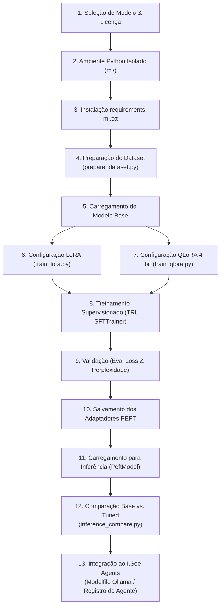

# 08. Pipeline Reproduzível de Treinamento (13 Etapas de Ponta a Ponta)

**Projeto:** I.See Agents — Multi-Agent AI Platform  
**Autor:** Júlio César | **Organização:** I.See Technologies (`https://iseetechnologies.com.br/`)  
**Repositório:** `securityMaker488/isee-agents`  
**Escopo do Documento:** Guia operacional passo a passo cobrindo as 13 etapas obrigatórias do ciclo de vida de treinamento supervisionado (LoRA e QLoRA), validação, comparação de inferência e integração com a plataforma I.See Agents.

---

## 1. Visão Geral Arquitetural do Pipeline

O pipeline de Machine Learning do **I.See Agents** foi projetado no diretório [`ml/`](file:///C:/Users/golde/.gemini/antigravity/scratch/isee-agents/ml) de forma completamente desacoplada do runtime web (`backend/`), evitando inflar a imagem de produção FastAPI com dependências pesadas de treinamento (`trl`, `peft`, `bitsandbytes`, `accelerate`).



> [!NOTE]
> **Transparência sobre Execução em Hardware Sem GPU Dedicada:**
> - **O que foi implementado e validado no repositório:** Todos os scripts em [`ml/experiments/`](file:///C:/Users/golde/.gemini/antigravity/scratch/isee-agents/ml/experiments) (`train_lora.py`, `train_qlora.py`, `inference_compare.py`, `evaluate_agent.py`) são 100% funcionais e possuem **detecção automática de hardware**.
> - **Modo de Verificação / Micro-Modelo (CPU):** Em máquinas de desenvolvimento sem GPU NVIDIA dedicada, os scripts suportam a flag `--smoke-test` (ou fallback automático em CPU) utilizando um micro-modelo causal (`sshleifer/tiny-gpt2` ou `Qwen/Qwen2.5-0.5B-Instruct`) para validar toda a cadeia de engenharia (tokenização, injeção de adaptadores PEFT, *forward/backward pass*, salvamento de `adapter_model.safetensors` e comparação de inferência) em poucos segundos.
> - **Modo de Produção / Treinamento Pesado (GPU):** Em servidores Linux equipados com GPUs NVIDIA (RTX 3090/4090, L4, A10, A100), os mesmos scripts executam o treinamento em escala real sobre modelos de 3B, 7B/8B ou 14B parâmetros sem necessidade de alterar uma única linha de código.

---

## 2. As 13 Etapas do Pipeline Reproduzível

### Etapa 1: Seleção de Modelo e Verificação da Licença

Antes de iniciar qualquer experimento, selecionamos a família de modelos base avaliando três critérios: suporte nativo ao idioma português, capacidade de *instruction following* e licença permissiva para uso comercial.

| Modelo Base (Hugging Face Hub) | Parâmetros | Licença | Uso Recomendado no I.See Agents |
| :--- | :--- | :--- | :--- |
| `Qwen/Qwen2.5-0.5B-Instruct` | 0.5B | **Apache-2.0** | Validação rápida de pipeline em CPU / Dispositivos de borda |
| `Qwen/Qwen2.5-3B-Instruct` | 3.0B | **Qwen Research / Apache (ver versão)** | Agentes rápidos de triagem e classificação em GPUs de 6 GB |
| `Qwen/Qwen2.5-7B-Instruct` | 7.6B | **Apache-2.0** | **Padrão Ouro Recomendado:** Excelente raciocínio, código e português |
| `meta-llama/Llama-3.1-8B-Instruct` | 8.0B | **Llama 3.1 Community** | Agentes generalistas e analistas de segurança/arquitetura |
| `mistralai/Mistral-7B-Instruct-v0.3` | 7.3B | **Apache-2.0** | Tarefas de sumarização, RAG estrito e redação técnica |

---

### Etapa 2: Configuração do Ambiente Python Isolado (`ml/`)

O ambiente de treinamento deve ser isolado em um `venv` dedicado para evitar conflitos de versão do PyTorch/CUDA com o backend web:

```bash
# No diretório raiz do repositório isee-agents
python3 -m venv .venv-ml

# Ativação no Debian/Ubuntu Linux:
source .venv-ml/bin/activate

# Ativação no Windows PowerShell:
.\.venv-ml\Scripts\Activate.ps1
```

---

### Etapa 3: Instalação das Dependências (`requirements-ml.txt`)

O arquivo [`ml/requirements-ml.txt`](file:///C:/Users/golde/.gemini/antigravity/scratch/isee-agents/ml/requirements-ml.txt) reúne todas as bibliotecas do ecossistema de ajuste fino:

```bash
pip install --upgrade pip
pip install -r ml/requirements-ml.txt
```

Principais pacotes instalados:
- `torch>=2.2.0` (Motor de tensores e autograd)
- `transformers>=4.44.0` (Arquiteturas de modelos e tokenizadores)
- `datasets>=2.20.0` (Carregamento e mapeamento eficiente em Arrow)
- `peft>=0.12.0` (Injeção de adaptadores LoRA/QLoRA)
- `trl>=0.10.0` (`SFTTrainer` e `SFTConfig` para ajuste supervisionado)
- `bitsandbytes>=0.43.3` (Quantização 4-bit NF4 e otimizadores paginados)
- `accelerate>=0.33.0` (Distribuição de dispositivos e precisão mista)
- `safetensors>=0.4.4` (Serialização segura de pesos sem execução arbitrária de `pickle`)

---

### Etapa 4: Preparação do Dataset

Executamos o pipeline de higienização, anonimização de PII, deduplicação SHA-256 e divisão estratificada (`train.jsonl`, `val.jsonl`, `test.jsonl`) documentado no capítulo anterior:

```bash
python ml/datasets/prepare_dataset.py \
  --input ml/datasets/synthetic_agents.jsonl \
  --output-dir ml/datasets/processed \
  --seed 42
```

Verifique o arquivo `ml/datasets/processed/dataset_manifest.json` para confirmar `"leakage_check_passed": true`.

---

### Etapa 5: Carregamento do Modelo Base e Tokenizador

Nos scripts [`ml/experiments/train_lora.py`](file:///C:/Users/golde/.gemini/antigravity/scratch/isee-agents/ml/experiments/train_lora.py) e [`ml/experiments/train_qlora.py`](file:///C:/Users/golde/.gemini/antigravity/scratch/isee-agents/ml/experiments/train_qlora.py), o modelo base e o tokenizador são carregados garantindo que o `pad_token` esteja configurado corretamente (modelos como Llama e Qwen frequentemente não definem `pad_token` por padrão, exigindo alinhamento com `eos_token` e `padding_side="right"` durante o treinamento causal):

```python
from transformers import AutoModelForCausalLM, AutoTokenizer

tokenizer = AutoTokenizer.from_pretrained(model_name, use_fast=True)
if tokenizer.pad_token is None:
    tokenizer.pad_token = tokenizer.eos_token
tokenizer.padding_side = "right"  # Obrigatório para treinamento Causal LM sem overflow de atenção
```

---

### Etapa 6: Configuração de LoRA Padrão (`train_lora.py`)

Para execuções em `float16`/`bfloat16` (GPUs com VRAM ampla) ou validação em CPU (`float32`), configuramos o `LoraConfig` diretamente sobre o modelo base:

```python
from peft import LoraConfig, TaskType, get_peft_model

lora_config = LoraConfig(
    r=16,
    lora_alpha=32,
    lora_dropout=0.05,
    bias="none",
    task_type=TaskType.CAUSAL_LM,
    target_modules=["q_proj", "k_proj", "v_proj", "o_proj", "gate_proj", "up_proj", "down_proj"],
)
model = get_peft_model(model, lora_config)
```

Comando de execução:

```bash
# Modo de validação rápida (CPU ou GPU):
python ml/experiments/train_lora.py --smoke-test

# Modo de treinamento LoRA completo:
python ml/experiments/train_lora.py \
  --model-name Qwen/Qwen2.5-0.5B-Instruct \
  --dataset-path ml/datasets/processed/train.jsonl \
  --eval-dataset-path ml/datasets/processed/val.jsonl \
  --output-dir ml/outputs/lora-isee-agent \
  --epochs 3 \
  --batch-size 2 \
  --grad-accum 4
```

---

### Etapa 7: Configuração de QLoRA em 4 Bits (`train_qlora.py`)

Quando uma GPU NVIDIA compatível está presente, ativamos a quantização NF4 de 4 bits com Double Quantization e preparamos o modelo para treinamento *k-bit*:

```python
from transformers import BitsAndBytesConfig
from peft import prepare_model_for_kbit_training

bnb_config = BitsAndBytesConfig(
    load_in_4bit=True,
    bnb_4bit_quant_type="nf4",
    bnb_4bit_use_double_quant=True,
    bnb_4bit_compute_dtype=torch.bfloat16 if torch.cuda.is_bf16_supported() else torch.float16,
)

model = AutoModelForCausalLM.from_pretrained(
    model_name,
    quantization_config=bnb_config,
    device_map="auto",
)
model = prepare_model_for_kbit_training(model, use_gradient_checkpointing=True)
model = get_peft_model(model, lora_config)
```

Comando de execução:

```bash
python ml/experiments/train_qlora.py \
  --model-name Qwen/Qwen2.5-7B-Instruct \
  --dataset-path ml/datasets/processed/train.jsonl \
  --eval-dataset-path ml/datasets/processed/val.jsonl \
  --output-dir ml/outputs/qlora-isee-agent \
  --epochs 3
```

---

### Etapa 8: Treinamento Supervisionado com TRL (`SFTTrainer`)

O `SFTTrainer` da biblioteca `trl` gerencia a formatação ChatML, o cálculo da função de custo (*Cross-Entropy Loss*), o acúmulo de gradientes e o escalonamento da taxa de aprendizado (`cosine` schedule com *warmup*):

```python
from trl import SFTConfig, SFTTrainer

sft_config = SFTConfig(
    output_dir=output_dir,
    num_train_epochs=epochs,
    per_device_train_batch_size=batch_size,
    gradient_accumulation_steps=grad_accum,
    learning_rate=2e-4,
    lr_scheduler_type="cosine",
    warmup_ratio=0.05,
    eval_strategy="epoch",
    save_strategy="epoch",
    logging_steps=5,
    max_seq_length=1024,
    dataset_text_field="text",
    report_to="none",
)

trainer = SFTTrainer(
    model=model,
    args=sft_config,
    train_dataset=train_dataset,
    eval_dataset=val_dataset,
    processing_class=tokenizer,
)
train_result = trainer.train()
```

---

### Etapa 9: Validação Matemática do Modelo

Imediatamente após o término das épocas de treino, avaliamos o modelo no conjunto `val.jsonl` (nunca visto durante a atualização de pesos) para calcular a `eval_loss` e a **Perplexidade ($\text{PPL}$)**:

$$\text{Perplexity (PPL)} = \exp(\mathcal{L}_{\text{eval}})$$

```python
import math

eval_metrics = trainer.evaluate()
eval_loss = eval_metrics["eval_loss"]
perplexity = math.exp(eval_loss) if eval_loss < 20 else float("inf")
print(f"Eval Loss: {eval_loss:.4f} | Perplexity: {perplexity:.2f}")
```

- Se `train_loss` cai continuamente enquanto `eval_loss` começa a subir após a época 2, há **overfitting**: deve-se reduzir o número de épocas, aumentar `lora_dropout` (ex.: `0.1`) ou ampliar a diversidade do dataset.

---

### Etapa 10: Salvamento dos Adaptadores e Manifesto de Treinamento

Em vez de salvar gigabytes do modelo base inteiro, salvamos apenas os pesos diferenciais dos adaptadores (`adapter_model.safetensors`, tipicamente de 20 MB a 160 MB), a configuração (`adapter_config.json`), o tokenizador e um relatório `training_summary.json`:

```python
trainer.model.save_pretrained(output_dir)
tokenizer.save_pretrained(output_dir)
```

Arquivos gerados no diretório `ml/outputs/qlora-isee-agent/`:
- `adapter_config.json` (Hiperparâmetros exatos do LoRA e nome do modelo base)
- `adapter_model.safetensors` (Matrizes treinadas $A$ e $B$ em formato seguro)
- `tokenizer.json` e `tokenizer_config.json`
- `training_summary.json` (Métricas de perda, perplexidade, duração e hardware utilizado)

---

### Etapa 11: Carregamento para Inferência (`PeftModel`)

Para executar inferência com o adaptador recém-treinado, carregamos o modelo base congelado e acoplamos o adaptador usando `PeftModel.from_pretrained`:

```python
from transformers import AutoModelForCausalLM, AutoTokenizer
from peft import PeftModel

base_model = AutoModelForCausalLM.from_pretrained(base_model_name, device_map="auto")
tuned_model = PeftModel.from_pretrained(base_model, "ml/outputs/qlora-isee-agent")
tuned_model.eval()
```

---

### Etapa 12: Comparação com o Modelo Original (`inference_compare.py`)

O script [`ml/experiments/inference_compare.py`](file:///C:/Users/golde/.gemini/antigravity/scratch/isee-agents/ml/experiments/inference_compare.py) executa o mesmo conjunto de prompts de teste lado a lado no **Modelo Base Original** (com os adaptadores desativados via contexto `with model.disable_adapter():` ou instância separada) e no **Modelo Ajustado (LoRA/QLoRA)**, medindo latência, velocidade de geração (`tokens/s`) e aderência estrutural:

```bash
python ml/experiments/inference_compare.py \
  --base-model Qwen/Qwen2.5-0.5B-Instruct \
  --adapter-dir ml/outputs/lora-isee-agent \
  --test-file ml/datasets/processed/test.jsonl \
  --output-report ml/outputs/comparison_report.json
```

---

### Etapa 13: Integração do Resultado à Plataforma I.See Agents

Uma vez aprovado nos critérios de avaliação (Capítulo 09), o adaptador é integrado ao runtime do **I.See Agents** por um de dois caminhos suportados:

1. **Via Diretiva `ADAPTER` no `Modelfile` do Ollama (Sem Fusão Total):**
   Converte-se apenas o diretório do adaptador PEFT para GGUF (`convert_lora_to_gguf.py` do `llama.cpp`) e referencia-se o arquivo no `Modelfile`:
   ```dockerfile
   FROM qwen2.5:7b
   ADAPTER ./qlora-isee-agent.gguf
   PARAMETER temperature 0.2
   ```
2. **Via Fusão de Pesos (`merge_and_unload`) + Quantização GGUF:**
   Funde-se matematicamente $W = W_0 + \frac{\alpha}{r}BA$ em `float16`, exporta-se para GGUF (`Q4_K_M`) e registra-se o modelo resultante no Ollama (`ollama create isee-sec-agent -f Modelfile`), vinculando o nome do modelo ao campo `model_name` do agente no banco PostgreSQL do I.See Agents.
