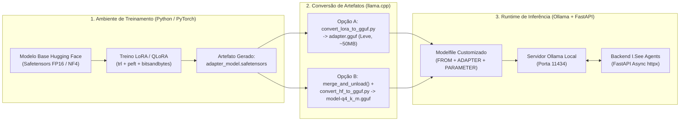

# 11. Integração Completa com Ollama (Inferência Local, Modelfiles e Gestão de Memória)

**Projeto:** I.See Agents — Multi-Agent AI Platform  
**Autor:** Júlio César | **Organização:** I.See Technologies (`https://iseetechnologies.com.br/`)  
**Repositório:** `securityMaker488/isee-agents`  
**Escopo do Documento:** Guia arquitetural e operacional da integração entre o backend FastAPI do **I.See Agents** e o runtime local **Ollama**, cobrindo instalação, `Modelfile` customizado com diretiva `ADAPTER`, endpoints assíncronos (`/api/tags`, `/api/chat`, `/api/embeddings`), variáveis de controle de memória VRAM/RAM e a separação estrita entre Treinamento (PyTorch/PEFT), Conversão (GGUF) e Inferência (Ollama).

---

## 1. Diferenciação Arquitetural: Treinamento vs. Conversão vs. Inferência

Um ponto fundamental de arquitetura de MLOps é compreender que **o Ollama é um motor de inferência em C/C++ e Go (baseado em `llama.cpp` / `ggml`), e não um framework de treinamento**. Portanto, o ciclo de vida no **I.See Agents** separa rigorosamente três ambientes:



| Etapa | Tecnologia Principal | Formato de Pesos | Papel no I.See Agents |
| :--- | :--- | :--- | :--- |
| **1. Treinamento / Fine-Tuning** | Python, PyTorch, `transformers`, `peft`, `trl`, `bitsandbytes` | `.safetensors` (`bfloat16` / `NF4`) | Calcula gradientes via *backpropagation* e atualiza as matrizes $A$ e $B$ em [`ml/experiments/`](file:///C:/Users/golde/.gemini/antigravity/scratch/isee-agents/ml/experiments). |
| **2. Conversão e Quantização Pós-Treino** | `llama.cpp` (`convert_lora_to_gguf.py` ou `convert_hf_to_gguf.py`) | `.gguf` (`F16`, `Q8_0`, `Q4_K_M`) | Converte tensores Safetensors para o formato binário otimizado de inferência `GGUF`. |
| **3. Inferência em Produção** | **Ollama** + `backend/app/services/ollama_service.py` | `.gguf` mapeado via `mmap` | Executa geração de tokens, *streaming* SSE, visão multimodal e cálculo de embeddings com baixa latência. |

---

## 2. Instalação e Execução de Modelos Locais no Ollama

### 2.1 Instalação no Debian/Ubuntu Linux

```bash
# Instalação oficial do binário e serviço systemd do Ollama
curl -fsSL https://ollama.com/install.sh | sh

# Verificar status do serviço
sudo systemctl status ollama
```

### 2.2 Download dos Modelos Recomendados para o I.See Agents

```bash
# 1. Modelo de Linguagem Leve / Rápido (excelente para máquinas com 8 GB de RAM ou 4 GB VRAM)
ollama pull llama3.2:3b

# 2. Modelo de Linguagem Principal para Agentes Técnicos (recomendado 16 GB RAM ou GPU 8 GB VRAM)
ollama pull qwen2.5:7b

# 3. Modelo de Embeddings Semânticos para o RAG (muito leve, ~274 MB, altíssima precisão)
ollama pull nomic-embed-text

# 4. Modelo Multimodal de Visão (para upload e análise de imagens no chat)
ollama pull llava:7b
```

---

## 3. Criação de `Modelfile` Customizado e Diretiva `ADAPTER`

O Ollama permite empacotar configurações de agente, parâmetros determinísticos e adaptadores LoRA diretamente em um arquivo declarativo chamado `Modelfile`.

### 3.1 `Modelfile` com Acoplamento de Adaptador LoRA (`ADAPTER`)

Após treinar um adaptador com [`ml/experiments/train_qlora.py`](file:///C:/Users/golde/.gemini/antigravity/scratch/isee-agents/ml/experiments/train_qlora.py) e convertê-lo para GGUF (ou apontar para o diretório de adaptador compatível), criamos o arquivo `Modelfile.isee-security`:

```dockerfile
# Define o modelo base já instalado localmente no Ollama
FROM qwen2.5:7b

# Acopla o adaptador LoRA/QLoRA sem duplicar os pesos do modelo base
ADAPTER ./ml/outputs/qlora-isee-agent/adapter.gguf

# Parâmetros de decodificação e janela de contexto
PARAMETER temperature 0.15
PARAMETER top_p 0.9
PARAMETER top_k 40
PARAMETER repeat_penalty 1.1
PARAMETER num_ctx 8192
PARAMETER num_predict 2048

# System Prompt padrão embutido no artefato do modelo
SYSTEM """
Você é um Agente Especialista da plataforma I.See Agents (I.See Technologies).
Responda sempre em português técnico com precisão, segurança e fundamentação nos documentos fornecidos.
"""
```

Comandos para registrar e testar o modelo customizado no Ollama:

```bash
# Cria o modelo local a partir do Modelfile
ollama create isee-security-agent:1.0 -f Modelfile.isee-security

# Verifica se o modelo aparece na listagem local
ollama list

# Teste rápido via terminal
ollama run isee-security-agent:1.0 "Explique como mitigar SSRF em webhooks Python."
```

---

## 4. Integração Assíncrona com o Backend FastAPI

No backend do **I.See Agents** (`backend/app/services/ollama_service.py`), todas as chamadas ao servidor Ollama (`http://localhost:11434` por padrão, configurável via `OLLAMA_BASE_URL`) utilizam `httpx.AsyncClient` para não bloquear o *event loop* ASGI do FastAPI durante inferências longas.

### 4.1 Endpoints Consumidos pelo I.See Agents

1. **`GET /api/tags` — Descoberta e Healthcheck de Modelos Locais:**
   Lista todos os modelos instalados no host, seus tamanhos em bytes, famílias e níveis de quantização (`Q4_K_M`, `Q8_0`), permitindo que o frontend exiba um seletor atualizado de modelos disponíveis.
2. **`POST /api/chat` — Conversação Multi-Turno, Streaming SSE e Visão Multimodal:**
   Recebe o histórico estruturado `messages` (`system`, `user`, `assistant`) e, quando há imagens anexadas, o array `images` codificado em Base64. Suporta `stream: true` (para *Server-Sent Events* em tempo real na UI) e `stream: false`.
3. **`POST /api/embeddings` (ou `/api/embed`) — Geração de Vetores para o RAG:**
   Converte fragmentos de documentos e perguntas do usuário em vetores densos de ponto flutuante que são persistidos e consultados no PostgreSQL com `pgvector`.

### 4.2 Exemplo de Cliente Assíncrono Resiliente (`httpx`)

```python
import httpx
from typing import AsyncGenerator, Any

class OllamaClient:
    def __init__(self, base_url: str = "http://localhost:11434", timeout: float = 120.0):
        self.base_url = base_url.rstrip("/")
        self.timeout = httpx.Timeout(timeout, connect=10.0)

    async def list_models(self) -> list[dict[str, Any]]:
        async with httpx.AsyncClient(timeout=self.timeout) as client:
            resp = await client.get(f"{self.base_url}/api/tags")
            resp.raise_for_status()
            return resp.json().get("models", [])

    async def chat_stream(
        self,
        model: str,
        messages: list[dict[str, Any]],
        options: dict[str, Any] | None = None,
        keep_alive: str = "15m",
    ) -> AsyncGenerator[str, None]:
        payload = {
            "model": model,
            "messages": messages,
            "stream": True,
            "options": options or {"temperature": 0.2, "num_ctx": 4096},
            "keep_alive": keep_alive,
        }
        async with httpx.AsyncClient(timeout=self.timeout) as client:
            async with client.stream("POST", f"{self.base_url}/api/chat", json=payload) as resp:
                resp.raise_for_status()
                async for line in resp.aiter_lines():
                    if line:
                        import json
                        chunk = json.loads(line)
                        content = chunk.get("message", {}).get("content", "")
                        if content:
                            yield content
```

---

## 5. Gerenciamento de Parâmetros de Inferência e Memória

Em servidores compartilhados ou estações de trabalho onde o PostgreSQL, o FastAPI e o Ollama coexistem, o gerenciamento rigoroso de memória no Ollama evita *swapping* de disco e falhas de OOM.

### 5.1 Variáveis de Ambiente do Servidor Ollama

Configure estas variáveis na unidade `systemd` (`/etc/systemd/system/ollama.service.d/override.conf`):

| Variável de Ambiente | Valor Recomendado | Impacto na Memória e Concorrência |
| :--- | :--- | :--- |
| `OLLAMA_NUM_PARALLEL` | `2` (ou `4` em GPUs $\ge 24\text{ GB}$) | Define quantas requisições simultâneas um único modelo carregado processa em paralelo. **Atenção:** Cada slot paralelo multiplica a alocação do buffer de `KV Cache` (`num_ctx`). |
| `OLLAMA_MAX_LOADED_MODELS` | `2` (1 LLM + 1 Embedding) | Limita quantos modelos distintos podem permanecer simultaneamente na VRAM/RAM. Manter em `2` permite que o modelo de chat (`qwen2.5:7b`) e o modelo de RAG (`nomic-embed-text`) fiquem carregados juntos sem *thrashing*. |
| `OLLAMA_KEEP_ALIVE` | `15m` (ou `-1` para fixar) | Tempo que o modelo permanece carregado em memória após a última requisição antes de ser descarregado automaticamente. |
| `OLLAMA_FLASH_ATTENTION` | `1` | Ativa *Flash Attention*, reduzindo drasticamente o consumo de memória do KV Cache em contextos longos (`num_ctx >= 8192`) e acelerando o *prefill*. |
| `OLLAMA_KV_CACHE_TYPE` | `q8_0` (opcional) | Quantiza o KV Cache em 8 bits, reduzindo pela metade a memória consumida pelo contexto longo com impacto desprezível na qualidade. |

### 5.2 Controle Fino de `num_ctx` (Janela de Contexto)

Por padrão, o Ollama carrega modelos com `num_ctx = 2048` (ou `4096`). No **I.See Agents**, quando o RAG injeta múltiplos trechos de documentos juntamente com o histórico da conversa, recomenda-se enviar `"options": {"num_ctx": 8192}` na chamada `/api/chat`. Evite definir `num_ctx = 32768` ou `131072` sem necessidade real, pois o KV Cache cresce linearmente com `num_ctx * OLLAMA_NUM_PARALLEL`.

---

## 6. Avaliação e Monitoramento de Desempenho no Debian Linux

A resposta final do Ollama (no último pacote JSON quando `done: true`) retorna telemetria nativa em nanossegundos que o **I.See Agents** utiliza para diagnóstico:

- `load_duration`: Tempo gasto carregando o modelo do disco para a RAM/VRAM (deve ser próximo de zero quando o modelo já está quente via `keep_alive`).
- `prompt_eval_count` e `prompt_eval_duration`: Número de tokens do prompt (System Prompt + RAG + Histórico) e tempo gasto na fase de *Prefill*.
- `eval_count` e `eval_duration`: Número de tokens gerados e tempo gasto na decodificação autoregressiva.

Fórmula exata de velocidade de geração reportada pelo motor:

$$\text{Velocidade de Geração (tokens/s)} = \frac{\texttt{eval\_count}}{\texttt{eval\_duration}} \times 10^9$$

Comandos úteis de diagnóstico no Debian Linux:

```bash
# Verificar quais modelos estão atualmente alocados na RAM / VRAM e o percentual de offload na GPU:
ollama ps

# Acompanhar logs de alocação de buffers CUDA/CPU e velocidade de avaliação do Ollama:
journalctl -u ollama -f
```
