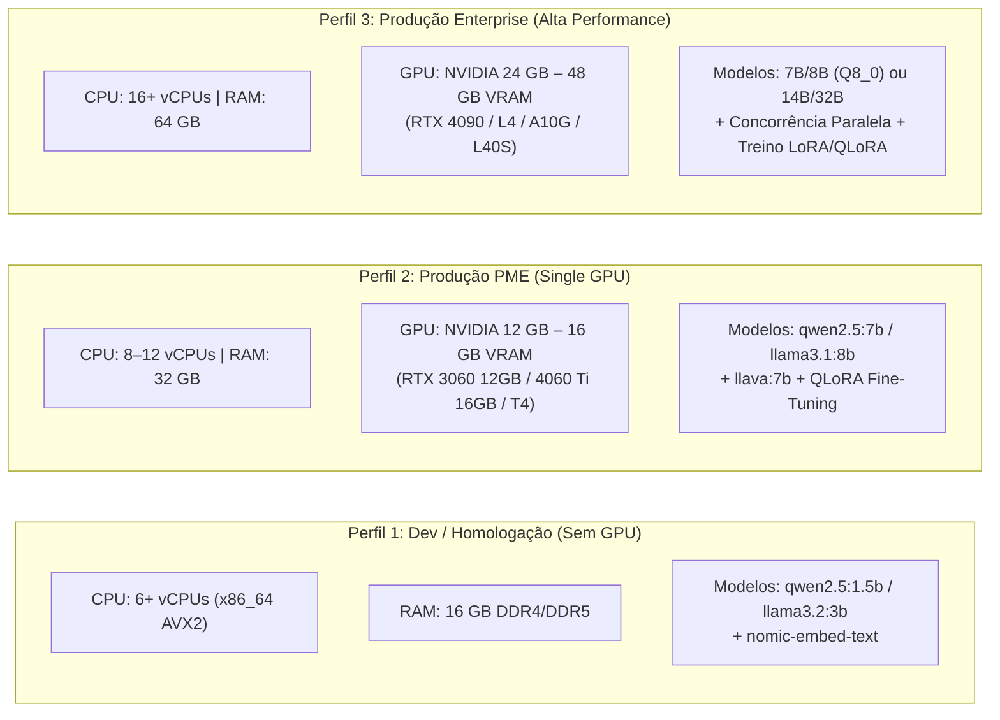

# 12. Dimensionamento Realista de Hardware (Inferência, RAG, LoRA e QLoRA)

**Projeto:** I.See Agents — Multi-Agent AI Platform  
**Autor:** Júlio César | **Organização:** I.See Technologies (`https://iseetechnologies.com.br/`)  
**Repositório:** `securityMaker488/isee-agents`  
**Escopo do Documento:** Guia de engenharia de capacidade (*Capacity Planning*) e fórmulas matemáticas de estimativa de VRAM/RAM para Inferência Local (CPU vs. GPU via Ollama), indexação/busca vetorial RAG (`pgvector`), ajuste fino LoRA (16-bit) e QLoRA (4-bit NF4) cobrindo modelos de **0.5B, 1.5B, 3B, 7B/8B, 14B e 70B parâmetros**.

---

## 1. Fórmulas Práticas de Cálculo de Memória VRAM / RAM

Planejar infraestrutura de IA exige calcular deterministicamente o consumo de memória antes de alocar servidores ou iniciar treinamentos.

### 1.1 Fórmula para Inferência (Quantização GGUF / AWQ / FP16)

Durante a inferência, a memória total necessária ($M_{\text{inf}}$) é a soma dos pesos estáticos do modelo, do cache de atenção chave-valor (**KV Cache**) proporcional ao tamanho do contexto e do overhead de buffers de execução (CUDA context / `ggml` compute buffer):

$$M_{\text{inf}} = \underbrace{\left(P \times \frac{b}{8}\right)}_{\text{Pesos do Modelo}} + \underbrace{\left(2 \times L \times H_{\text{kv}} \times d_k \times S \times B \times \frac{b_{\text{kv}}}{8}\right)}_{\text{KV Cache}} + \underbrace{M_{\text{overhead}}}_{\sim 0.5\text{ a }1.2\text{ GB}}$$

Onde:
- $P$: Número de parâmetros do modelo (ex.: $7.6 \times 10^9$ para Qwen2.5-7B).
- $b$: Bits por peso na quantização (ex.: `4.5` bits efetivos em `Q4_K_M`, `8.5` bits em `Q8_0`, `16` bits em `FP16`).
- $L$: Número de camadas Transformer; $H_{\text{kv}}$: cabeças de atenção KV (*Grouped-Query Attention - GQA* reduz drasticamente este termo); $d_k$: dimensão de cada cabeça; $S$: tamanho do contexto (`num_ctx`); $B$: requisições paralelas (`OLLAMA_NUM_PARALLEL`).

**Regra de Bolso Rápida para Inferência (`Q4_K_M`, contexto de `4096` a `8192` tokens):**

$$M_{\text{inf (Q4\_K\_M)}} \approx (P_{\text{bilhões}} \times 0.65\text{ GB}) + 1.0\text{ GB}$$

---

### 1.2 Fórmula para Treinamento QLoRA (4-bit NF4 + Double Quantization)

No treinamento QLoRA (`batch_size = 1` a `2`, `seq_len = 2048`, com *Gradient Checkpointing* e `paged_adamw_8bit`), a memória VRAM total ($M_{\text{QLoRA}}$) é composta por:

$$M_{\text{QLoRA}} = \underbrace{(P \times 0.516\text{ bytes})}_{\text{Base NF4 + DQ}} + \underbrace{(P_{\text{LoRA}} \times 6\text{ bytes})}_{\text{Pesos LoRA + Grad + PagedOpt}} + \underbrace{M_{\text{activations}}}_{\text{Ativações + CUDA Kernels}}$$

**Regra de Bolso Rápida para QLoRA (`r=16`, `seq_len=2048`, Gradient Checkpointing ativo):**

$$M_{\text{QLoRA}} \approx (P_{\text{bilhões}} \times 0.75\text{ GB}) + 1.8\text{ GB}$$

---

### 1.3 Fórmula para Treinamento LoRA Padrão em 16 Bits (`bfloat16` / `float16`)

Como o modelo base permanece em 16 bits (`2 bytes` por parâmetro):

$$M_{\text{LoRA-16bit}} \approx (P_{\text{bilhões}} \times 2.1\text{ GB}) + 2.5\text{ GB}$$

---

## 2. Matriz Completa por Escala de Modelo (0.5B a 70B Parâmetros)

A tabela abaixo consolida os requisitos reais de memória para todas as faixas de modelos utilizadas ou suportadas pelo **I.See Agents**:

| Escala do Modelo (Exemplo) | Inferência GGUF `Q4_K_M` (VRAM ou RAM) | Inferência `FP16` (VRAM) | Treino **QLoRA 4-bit** (`NF4`, `seq=2048`) | Treino **LoRA 16-bit** (`BF16`, `seq=2048`) | Hardware Recomendado (GPU / Host) |
| :--- | :--- | :--- | :--- | :--- | :--- |
| **0.5B** (`Qwen2.5-0.5B`) | **~0.8 GB** | ~1.5 GB | **~1.8 GB** | **~2.6 GB** | Qualquer CPU moderna (8 GB RAM) ou GPU de entrada (4 GB VRAM). |
| **1.5B** (`Qwen2.5-1.5B`) | **~1.4 GB** | ~3.5 GB | **~2.8 GB** | **~5.2 GB** | CPU (8–16 GB RAM) ou GPU GTX 1650 / RTX 3050 (4–6 GB VRAM). |
| **3B** (`Llama-3.2-3B` / `Qwen2.5-3B`) | **~2.4 GB** | ~6.8 GB | **~4.2 GB** | **~8.8 GB** | CPU Dual-Channel (16 GB RAM) ou GPU RTX 3060 / 4060 (8 GB VRAM). |
| **7B / 8B** (`Qwen2.5-7B` / `Llama-3.1-8B`) | **~5.5 GB** | ~16.5 GB | **~7.2 GB** | **~19.0 GB** | **Inferência/QLoRA:** RTX 3060 12GB / RTX 4060 Ti 16GB. **LoRA 16-bit:** RTX 3090/4090 (24 GB) ou NVIDIA L4. |
| **14B** (`Qwen2.5-14B`) | **~9.8 GB** | ~29.5 GB | **~12.5 GB** | **~33.0 GB** | **Inferência/QLoRA:** RTX 4080 (16 GB) / RTX 3090/4090 (24 GB). **LoRA 16-bit:** NVIDIA A100 40GB / L40S 48GB. |
| **70B** (`Llama-3.1-70B` / `Qwen2.5-72B`) | **~43.0 GB** | ~142.0 GB | **~46.0 GB** | **~155.0 GB** | **Inferência/QLoRA:** 1x A6000/L40S (48 GB) ou 2x RTX 3090/4090 (48 GB combinados). **LoRA 16-bit:** 2x a 3x A100/H100 80GB. |

---

## 3. Inferência Local: CPU-Only vs. Aceleração GPU

O motor do Ollama permite executar qualquer modelo GGUF puramente na CPU, em modo híbrido (*Layer Offloading* parcial entre RAM e VRAM) ou 100% na VRAM da GPU. O fator determinante na velocidade de geração de tokens (`tokens/s`) é a **largura de banda de memória (*Memory Bandwidth* em GB/s)**, pois a decodificação autoregressiva é limitada por I/O de memória (*memory-bandwidth bound*):

$$\text{TPS Máximo Teórico} \approx \frac{\text{Largura de Banda de Memória (GB/s)}}{\text{Tamanho dos Pesos do Modelo (GB)}}$$

| Perfil de Hardware | Largura de Banda Típica | Velocidade Real em Modelo **3B (`Q4_K_M`)** | Velocidade Real em Modelo **7B/8B (`Q4_K_M`)** | Viabilidade para o I.See Agents |
| :--- | :--- | :--- | :--- | :--- |
| **CPU DDR4 Dual-Channel** (ex.: Ryzen 5 / Core i5, 16 GB RAM) | ~35 – 45 GB/s | ~12 – 18 tokens/s | ~5 – 8 tokens/s | Bom para desenvolvimento local e agentes 1.5B–3B; lento para 8B com contexto longo. |
| **CPU DDR5 Dual/Quad-Channel** (ex.: Ryzen 9 / Xeon / EPYC, 32 GB RAM) | ~75 – 150 GB/s | ~25 – 40 tokens/s | ~12 – 22 tokens/s | Plenamente utilizável em servidores sem GPU para cargas moderadas com streaming SSE. |
| **GPU NVIDIA Mid-Range** (RTX 3060 12GB / RTX 4060 Ti 16GB) | ~288 – 360 GB/s | ~75 – 110 tokens/s | ~42 – 65 tokens/s | **Excelente custo-benefício** para 1 a 5 usuários concorrentes nos 12 agentes. |
| **GPU NVIDIA High-End / Data Center** (RTX 3090 / 4090 24GB / L4 / A100) | ~936 – 2.000 GB/s | >150 tokens/s | ~95 – 160 tokens/s | **Recomendado para Produção Corporativa:** Baixíssimo TTFT e alta concorrência. |

---

## 4. Dimensionamento para o Pipeline RAG e Banco Vetorial (`pgvector`)

O custo computacional e de memória do subsistema RAG no **I.See Agents** (`PostgreSQL 16 + pgvector`) é muito inferior ao do LLM e pode coexistir facilmente no mesmo servidor:

1. **Modelo de Embeddings (`nomic-embed-text` ou `all-MiniLM-L6-v2`):**
   - Tamanho em memória: **~280 MB a 550 MB**.
   - Latência de geração por chunk (500–800 caracteres): **~5 ms a 25 ms** em CPU moderna, ou **<3 ms** em GPU.
2. **Consumo de RAM e Disco no PostgreSQL (`pgvector` com índice HNSW):**
   - Cada vetor de `768` dimensões em `float32` (`vector(768)`) ocupa $768 \times 4\text{ bytes} = 3.072\text{ bytes}$ (~3 KB), mais metadados e ponteiros do grafo HNSW (~1.5x overhead).
   - **100.000 chunks documentais** (~50 milhões de palavras, equivalente a ~150.000 páginas de documentação técnica) consomem apenas **~750 MB a 900 MB de RAM/Disco** para manter o índice HNSW inteiramente em cache (`shared_buffers`).

---

## 5. Perfis Recomendados de Infraestrutura para o I.See Agents

