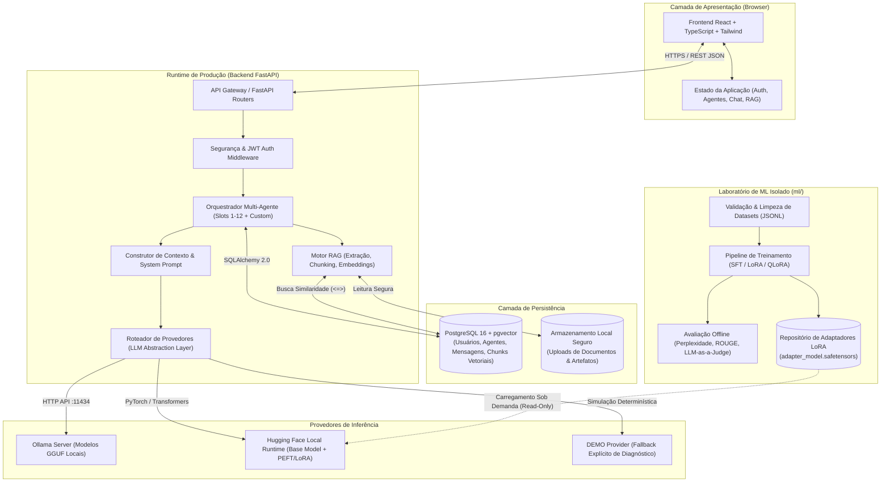
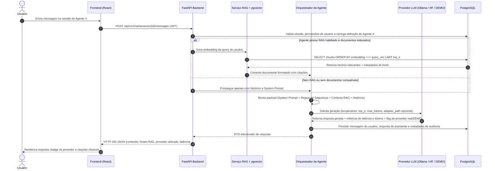

# Visão Geral da Arquitetura — I.See Agents

**Projeto:** I.See Agents — Multi-Agent AI Platform  
**Desenvolvedor:** Júlio César  
**Organização:** [I.See Technologies](https://iseetechnologies.com.br/)  
**Repositório:** `securityMaker488/isee-agents`

---

## 1. Introdução e Filosofia Arquitetural

A plataforma **I.See Agents** foi projetada sob os princípios de **modularidade estrita**, **isolamento de contexto multi-tenant**, **rastreabilidade de inferência** e **separação entre runtime de produção e laboratório de Machine Learning**.

Em vez de acoplar a interface do usuário diretamente a um único fornecedor de LLM ou misturar rotinas pesadas de ajuste fino (*fine-tuning*) com o servidor de aplicação web, a arquitetura divide responsabilidades em camadas bem definidas:

1. **Camada de Apresentação (Frontend SPA):** Interface reativa moderna construída em React 18, TypeScript e Tailwind CSS, comunicando-se via REST/JSON e streaming HTTP com a API.
2. **Camada de Aplicação e Orquestração (Backend API):** Servidor assíncrono em FastAPI com validação Pydantic v2, autenticação JWT, gerenciamento de sessões de chat, pipeline RAG nativo e orquestrador multi-agente.
3. **Camada de Abstração de Provedores de IA (`ModelProvider`):** Interface unificada que permite alternar ou combinar execução local via **Ollama Real**, execução local via **Hugging Face (`transformers` + `peft`)** para carregamento dinâmico de adaptadores LoRA/QLoRA, e um **DEMO Provider explícito** para validação determinística de fluxos de UI/API quando nenhum motor de inferência local está ativo.
4. **Camada de Persistência Híbrida (Relacional + Vetorial):** Banco de dados PostgreSQL 16 integrado à extensão `pgvector`, gerenciado via SQLAlchemy 2.0 e migrações Alembic, unificando metadados transacionais e busca semântica vetorial sob garantias ACID.
5. **Laboratório de Machine Learning Isolado (`ml/`):** Ambiente desacoplado do runtime da API, dedicado à preparação e validação de datasets (JSONL), experimentos de Supervised Fine-Tuning (SFT), treinamento de adaptadores LoRA/QLoRA, exportação de artefatos e avaliação offline.

---

## 2. Classificação de Escopo e Transparência Técnica

Para manter rigor de engenharia e clareza operacional, os componentes da plataforma são classificados em quatro categorias distintas:

| Categoria | Descrição Técnica | Onde Reside |
| :--- | :--- | :--- |
| **Funcionalidade Integrada na Plataforma** | Autenticação JWT, CRUD e catálogo de agentes (slots 1–12 + customizados), chat multi-sessão, pipeline RAG com `pgvector`, abstração de provedores (Ollama, HF Local, DEMO) e auditoria de uso. | `backend/`, `frontend/`, `docker-compose.yml` |
| **Exemplos Executáveis e Scripts de Engenharia** | Scripts funcionais de validação de datasets, geração de embeddings, treinamento LoRA/QLoRA parametrizado, inferência com adaptadores PEFT e suíte de avaliação. | `ml/scripts/`, `ml/configs/`, `ml/evaluation/` |
| **Experimentos Locais Viáveis** | Execução de modelos compactos (ex.: Qwen 2.5 0.5B/1.5B, TinyLlama 1.1B, Llama 3.2 1B/3B) via Ollama ou QLoRA 4-bit em GPUs domésticas/workstations (8 GB – 16 GB VRAM). | Ambiente local do engenheiro + `ml/` |
| **Documentação Conceitual e Trabalhos Futuros** | Fundamentos matemáticos de Transformers, escalabilidade multi-GPU (FSDP/DeepSpeed), alinhamento avançado via DPO em larga escala e integração futura do pacote JSON definitivo dos 12 agentes originais. | `docs/architecture/`, `docs/ai-training/` |

---

## 3. Diagrama de Arquitetura de Componentes

O diagrama abaixo ilustra a topologia completa da plataforma e a fronteira explícita entre o **Runtime de Produção** e o **Laboratório de ML (`ml/`)**:

---

## 4. Fluxo de Requisição de Inferência com RAG e Adaptadores

Quando um usuário envia uma mensagem para um agente na plataforma, o ciclo de vida da requisição percorre etapas determinísticas de validação, enriquecimento contextual e geração:

---

## 5. Detalhamento das Camadas da Plataforma

### 5.1 Frontend (`frontend/`)
Construído com **React 18**, **TypeScript** e **Tailwind CSS**, o cliente web prioriza clareza operacional para engenheiros e operadores de IA:
- **Catálogo de Agentes e Slots:** Visualização clara dos 12 slots reservados para os agentes originais da I.See Technologies e agentes personalizados criados pelo usuário.
- **Transparência de Execução:** Indicadores visuais em tempo real que informam se a resposta veio de um modelo real via **Ollama**, de um modelo local **Hugging Face + LoRA**, ou do **Modo DEMO** (nunca mascarando respostas simuladas como inferência real).
- **Gestão de Base de Conhecimento (RAG):** Interface para upload de arquivos (PDF, TXT, Markdown), inspeção de status de processamento, contagem de chunks e vinculação por agente.

### 5.2 Backend (`backend/`)
Implementado em **FastAPI**, segue princípios de *Clean Architecture* e separação de responsabilidades:
- `app/api/`: Controladores HTTP versionados (`/api/v1/auth`, `/api/v1/agents`, `/api/v1/chat`, `/api/v1/documents`, `/api/v1/system`).
- `app/models/`: Entidades ORM do SQLAlchemy mapeadas para tabelas relacionais e colunas vetoriais `Vector(dim)`.
- `app/schemas/`: Contratos de entrada/saída em Pydantic v2 com validação rigorosa de tipos e limites.
- `app/services/`: Lógica de domínio isolada para orquestração de agentes, ingestão documental, busca vetorial e roteamento de LLMs.

### 5.3 Abstração de Provedores de IA (`ModelProvider`)
Para evitar *vendor lock-in* e suportar diferentes perfis de hardware (desde notebooks sem GPU dedicada até servidores com aceleradores NVIDIA), o backend utiliza o padrão *Strategy* na camada de inferência:

1. **`OllamaProvider` (Produção Local Recomendada):** Conecta-se ao daemon do Ollama (`http://localhost:11434` ou container Docker) para executar modelos quantizados em formato GGUF (como `llama3.2`, `qwen2.5`, `mistral`, `deepseek-r1`).
2. **`HuggingFaceLocalProvider` (Inspeção e Adaptadores PEFT):** Carrega modelos diretamente via `transformers` e acopla adaptadores treinados no diretório `ml/artifacts/adapters/` utilizando `peft.PeftModel`. Ideal para testar ajustes finos LoRA/QLoRA sem necessidade de conversão imediata para GGUF.
3. **`DemoProvider` (Contingência Explícita):** Ativado apenas quando configurado explicitamente ou quando os motores locais estão indisponíveis e o fallback de demonstração é permitido. Toda resposta emitida por este provedor inclui metadados explícitos (`is_demo: true`, `provider: "demo"`) e aviso claro na interface.

### 5.4 Persistência Unificada (`PostgreSQL + pgvector`)
Em vez de manter um banco relacional separado de um banco vetorial externo (como Pinecone, Qdrant ou Milvus), o uso do **PostgreSQL com `pgvector`** oferece vantagens arquiteturais decisivas:
- **Consistência Transacional:** Quando um documento é excluído pelo usuário, seus metadados e todos os seus embeddings vetoriais são removidos na mesma transação (`ON DELETE CASCADE`), eliminando vetores órfãos.
- **Filtragem Híbrida Eficiente:** As queries vetoriais aplicam filtros relacionais (`WHERE user_id = :uid AND agent_id = :aid`) antes ou durante a varredura do índice HNSW, garantindo isolamento multi-tenant rigoroso.

---

## 6. Separação entre Runtime de Produção e Laboratório de ML (`ml/`)

Um erro comum em projetos de IA é executar pipelines de treinamento dentro de workers da API web. Isso causa contenção severa de VRAM, esgotamento de memória RAM (OOM) e indisponibilidade dos endpoints HTTP.

No **I.See Agents**, a separação é física e arquitetural:

| Aspecto | Runtime de Produção (`backend/`) | Laboratório de ML (`ml/`) |
| :--- | :--- | :--- |
| **Objetivo Primário** | Baixa latência, alta concorrência HTTP, orquestração de chat e busca RAG. | Alto throughput em batch, cálculo de gradientes, otimização de pesos e avaliação estatística. |
| **Operação com Pesos do Modelo** | Somente leitura (*Read-Only*), com `torch.no_grad()` e KV Cache ativado. | Leitura e escrita em tensores de adaptadores ($A$ e $B$), `backward()` ativo e *gradient checkpointing*. |
| **Consumo de Recursos** | Previsível e limitado pelo tamanho do modelo quantizado + contexto ativo. | Intensivo em GPU/VRAM (pesos + ativações + estados do otimizador AdamW). |
| **Artefato Gerado** | Logs de conversa, chunks indexados no banco e respostas ao usuário. | Pesos de adaptadores (`adapter_model.safetensors`), `adapter_config.json`, métricas de loss e relatórios JSON. |
| **Integração** | Consome adaptadores já validados e congelados através de caminhos seguros configurados no agente. | Produz e valida os adaptadores de forma assíncrona e independente da API. |

---

## 7. Segurança e Governança por Design

- **Isolamento de Escopo por Usuário e Agente:** Nenhum agente acessa documentos ou históricos de sessão pertencentes a outro usuário ou a outro agente não autorizado.
- **Sanitização de Uploads:** Validação de extensão, MIME type, tamanho máximo de arquivo e prevenção contra *Path Traversal* no armazenamento local.
- **Segredos via Variáveis de Ambiente:** Chaves de assinatura JWT, credenciais de banco de dados e URLs de provedores são injetadas exclusivamente via `.env` (validado por `pydantic-settings`), sem credenciais hardcoded no código-fonte.
