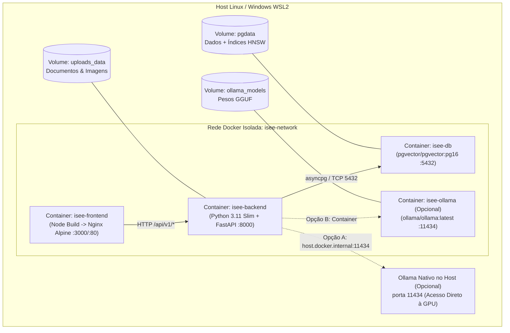

# Guia de Deploy Contêinerizado — Docker e Docker Compose

**Projeto:** I.See Agents — Multi-Agent AI Platform  
**Autor:** Júlio César | **Organização:** I.See Technologies (`https://iseetechnologies.com.br/`)  
**Repositório:** `securityMaker488/isee-agents`  
**Escopo do Documento:** Arquitetura de contêineres da plataforma **I.See Agents**, detalhando a orquestração via [`docker-compose.yml`](file:///C:/Users/golde/.gemini/antigravity/scratch/isee-agents/docker-compose.yml) (`db` com `pgvector/pgvector:pg16`, `backend` FastAPI, `frontend` React/Nginx), gerenciamento de volumes persistentes, padrões de comunicação com o Ollama (no host ou em contêiner dedicado com GPU) e execução de migrações Alembic.

---

## 1. Arquitetura dos Contêineres

O ambiente Docker do **I.See Agents** isola os serviços em uma rede virtual bridge privada (`isee-network`), expondo apenas as portas estritamente necessárias ao host:



### Papéis de Cada Serviço no `docker-compose.yml`

| Serviço | Imagem Base | Porta Interna | Responsabilidade Técnica |
| :--- | :--- | :--- | :--- |
| **`db`** | `pgvector/pgvector:pg16` | `5432` | Banco de dados relacional PostgreSQL 16 pré-compilado com a extensão C `pgvector` para armazenamento de usuários, agentes, conversas, mensagens e vetores de embeddings (`HNSW` / `IVFFlat`). |
| **`backend`** | `python:3.11-slim` (`backend/Dockerfile`) | `8000` | API REST e streaming SSE em FastAPI, autenticação JWT, extração de documentos (PDF/DOCX/TXT/MD), pipeline RAG e cliente assíncrono Ollama. Roda com usuário não-root. |
| **`frontend`** | Multi-stage (`node:20-alpine` $\rightarrow$ `nginx:alpine`) | `80` / `3000` | Interface web moderna e responsiva da plataforma I.See Agents servida estaticamente com proxy reverso para a API. |

---

## 2. Volumes Persistentes e Ciclo de Vida de Dados

Para garantir que nenhuma conversa, documento enviado ou índice vetorial seja perdido durante atualizações de imagem (`docker compose down && docker compose up -d --build`), o projeto utiliza volumes nomeados gerenciados pelo Docker Engine:

1. **`postgres_data` (`/var/lib/postgresql/data`):** Persiste todas as tabelas relacionais e os índices vetoriais `pgvector`.
2. **`backend_uploads` (`/app/uploads`):** Armazena de forma isolada os documentos originais enviados para o RAG e as imagens multimodais processadas pelos agentes.
3. **`ollama_data` (`/root/.ollama` — quando Ollama roda em container):** Evita baixar novamente gigabytes de modelos GGUF (`qwen2.5:7b`, `llama3.2:3b`, `nomic-embed-text`) a cada reinicialização de contêiner.

---

## 3. Comunicação com o Ollama: No Host vs. Em Contêiner

O **I.See Agents** suporta duas topologias para conexão do contêiner `backend` ao motor **Ollama**:

### Cenário A (Recomendado para Estações de Trabalho e Servidores com Ollama Nativo no Host)

O Ollama roda diretamente no sistema operacional host (aproveitando drivers CUDA/ROCm/Metal nativos sem overhead), e o contêiner `backend` conecta-se a ele via `host.docker.internal`:

No `docker-compose.yml`, o serviço `backend` inclui:

```yaml
services:
  backend:
    extra_hosts:
      - "host.docker.internal:host-gateway"
    environment:
      - OLLAMA_BASE_URL=http://host.docker.internal:11434
```

> [!TIP]
> **Configuração no Host Linux para Aceitar Conexões da Bridge Docker:**
> Por padrão, o Ollama escuta apenas em `127.0.0.1:11434`. Para que o contêiner Docker consiga alcançá-lo via `host.docker.internal`, configure `OLLAMA_HOST=0.0.0.0:11434` no serviço `ollama` do host e proteja a porta `11434` contra acesso externo usando o firewall `ufw deny 11434/tcp` (permitindo apenas a interface `docker0`).

---

### Cenário B (Stack 100% Contêinerizada com Passthrough de GPU NVIDIA)

Caso deseje executar o próprio Ollama dentro do `docker-compose.yml` com aceleração de GPU via **NVIDIA Container Toolkit**:

```yaml
  ollama:
    image: ollama/ollama:latest
    container_name: isee-ollama
    restart: unless-stopped
    volumes:
      - ollama_data:/root/.ollama
    environment:
      - OLLAMA_KEEP_ALIVE=15m
      - OLLAMA_NUM_PARALLEL=2
      - OLLAMA_MAX_LOADED_MODELS=2
    # Descomente o bloco deploy abaixo quando houver GPU NVIDIA + nvidia-container-toolkit instalado:
    # deploy:
    #   resources:
    #     reservations:
    #       devices:
    #         - driver: nvidia
    #           count: all
    #           capabilities: [gpu]
    networks:
      - isee-network
```

Neste cenário, basta definir `OLLAMA_BASE_URL=http://ollama:11434` no serviço `backend`.

---

## 4. Comandos Operacionais de Build, Execução e Migração Alembic

### 4.1 Subir Toda a Plataforma

```bash
# 1. Copiar o arquivo de exemplo de variáveis de ambiente e definir SECRET_KEY e senhas
cp .env.example .env

# 2. Construir as imagens e iniciar os contêineres em background
docker compose up -d --build

# 3. Verificar a saúde (healthcheck) dos serviços
docker compose ps
```

### 4.2 Gerenciamento de Migrações de Banco de Dados (Alembic)

O esquema do banco de dados (incluindo a ativação automática de `CREATE EXTENSION IF NOT EXISTS vector;` e a criação das tabelas `users`, `agents`, `conversations`, `messages`, `documents` e `document_chunks`) é gerenciado pelo **Alembic**:

```bash
# Aplicar todas as migrações pendentes até a versão mais recente (head)
docker compose exec backend alembic upgrade head

# Verificar a revisão atual do banco de dados
docker compose exec backend alembic current

# Gerar automaticamente uma nova migração após alterar modelos SQLAlchemy em backend/app/models/
docker compose exec backend alembic revision --autogenerate -m "descricao_da_alteracao"

# Reverter a última migração aplicada (rollback de 1 passo)
docker compose exec backend alembic downgrade -1
```

### 4.3 Baixar Modelos no Ollama Contêinerizado (Quando Aplicável)

```bash
# Baixar o modelo de chat e o modelo de embeddings dentro do contêiner ollama
docker compose exec ollama ollama pull qwen2.5:7b
docker compose exec ollama ollama pull nomic-embed-text

# Listar modelos disponíveis
docker compose exec ollama ollama list
```

### 4.4 Inspeção de Logs e Backup do Banco Vetorial

```bash
# Acompanhar logs em tempo real do backend FastAPI
docker compose logs -f backend

# Realizar dump completo (backup) do PostgreSQL + vetores pgvector
docker compose exec -T db pg_dump -U postgres -d isee_agents > backup_isee_agents_$(date +%F).sql
```
